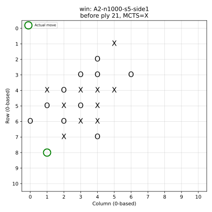
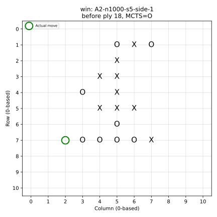
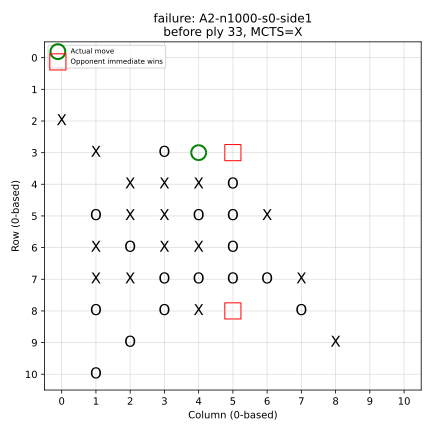
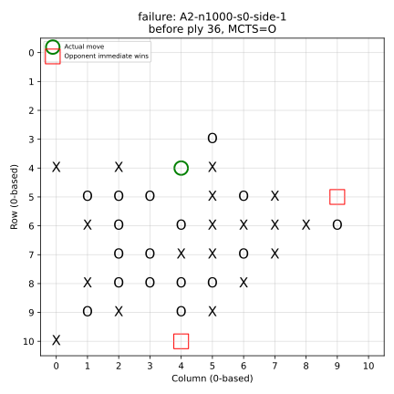

# Hai ablation tuần 7–8 

## A1 — Alpha-Beta ON/OFF

|scenario|alpha_beta|runs|action|score|nodes_mean|mean_ms|p95_ms|node_reduction_fraction|
|---|---|---|---|---|---|---|---|---|
|block_x_gap|False|30|(4, 5)|-220.1608|2076.0000|262.8669|599.3775|0.8960|
|block_x_gap|True|30|(4, 5)|-220.1608|216.0000|51.5563|105.2388|0.8960|
|midgame_x|False|30|(2, 8)|-0.0353|1336.0000|154.0640|429.3180|0.8907|
|midgame_x|True|30|(2, 8)|-0.0353|146.0000|37.5782|74.4297|0.8907|
|near_full_x|False|30|(10, 7)|-10.0255|12.0000|8.3189|19.4028|0.0833|
|near_full_x|True|30|(10, 7)|-10.0255|11.0000|7.8382|27.7387|0.0833|
|opening_x|False|30|(5, 5)|0.0020|10.0000|0.9880|2.1032|0.0000|
|opening_x|True|30|(5, 5)|0.0020|10.0000|1.0195|3.4726|0.0000|

Action và score trùng trong mọi cặp. Node là số lần step, cộng dồn iterative deepening; không phải số state duy nhất. Đây là 30 phép lặp thời gian trên từng state cố định, không phải 30 vị trí chiến thuật độc lập.

## A2 — Chỉ thay simulations

|simulations|paired_seeds|games|wins|draws|losses|score_rate|score_as_x|score_as_o|mean_ms|p95_ms|agent_moves|actual_simulations|nodes|tactical_override_moves|unique_trajectories|seed_score_std|
|---|---|---|---|---|---|---|---|---|---|---|---|---|---|---|---|---|
|100|30|60|0|0|60|0.0000|0.0000|0.0000|51.8074|125.8779|364|34600|34964|18|60|0.0000|
|400|30|60|4|1|55|0.0750|0.0667|0.0833|214.5494|487.0571|539|195200|194945|51|60|0.1726|
|1000|30|60|5|1|54|0.0917|0.1500|0.0333|563.8907|1131.8954|696|630000|627035|66|60|0.2281|

|comparison|paired_seeds|mean_score_delta|seed_delta_std|
|---|---|---|---|
|400-100|30|0.0750|0.1726|
|1000-100|30|0.0917|0.2281|

Mỗi mức có 30 cặp seed × 2 vai = 60 ván từ bàn rỗng, cùng đối thủ Heuristic. Rollout random có horizon 4, leaf evaluation pattern; các tham số khác giữ nguyên. Đây là cấu hình ablation công bố riêng, không đồng nhất với MCTS 8 simulations/epsilon_heuristic của tournament.
Tactical pre-check có thể trả ngay với 0 simulations; bảng ghi cả tổng simulations thực tế và số nước override. Latency dùng thời gian bao quanh choose_action, không gồm render.
Seed sensitivity nằm trong ablation_sensitivity.csv; paired delta dùng cùng seed giữa các ngân sách. Các trajectory trùng không được coi là quan sát độc lập. Chênh lệch X/O là mô tả theo vai, không chứng minh quan hệ nhân quả hoặc sức mạnh tổng quát.

## Hai ván thắng và hai failure case

### win — A2-n1000-s5-side1

MCTS là X (đi trước), ply 21, action (8, 1). MCTS chọn nước thắng ngay hợp lệ.

### win — A2-n1000-s5-side-1

MCTS là O (đi sau), ply 18, action (7, 2). MCTS chọn nước thắng ngay hợp lệ.

### failure — A2-n1000-s0-side1

MCTS là X (đi trước), ply 33, action (3, 4). Có nhiều hơn một nước thắng ngay của đối thủ: một nước chặn không thể giải hết threat.

### failure — A2-n1000-s0-side-1

MCTS là O (đi sau), ply 36, action (4, 4). Có nhiều hơn một nước thắng ngay của đối thủ: một nước chặn không thể giải hết threat.