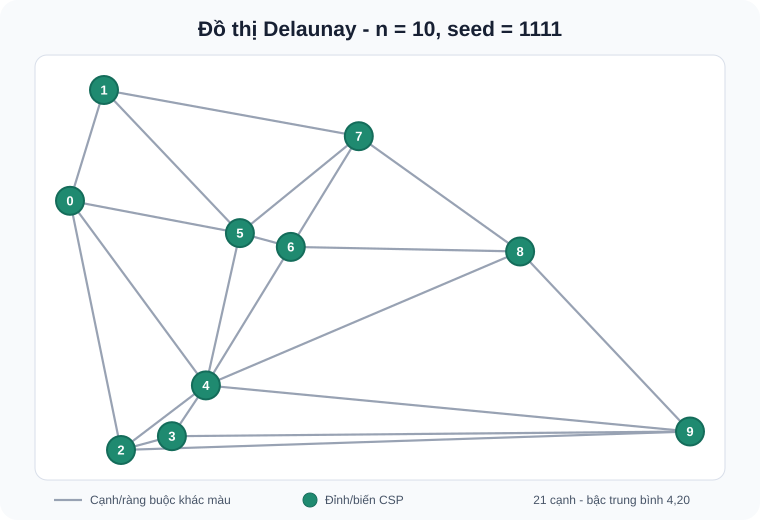
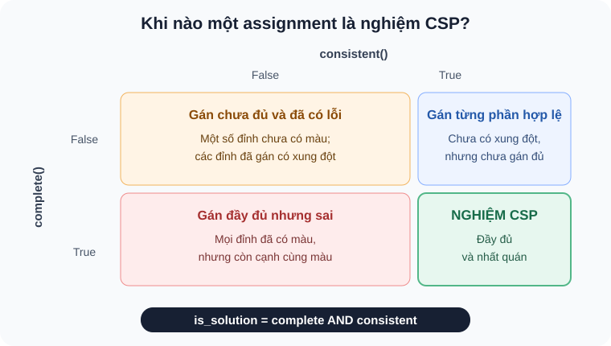
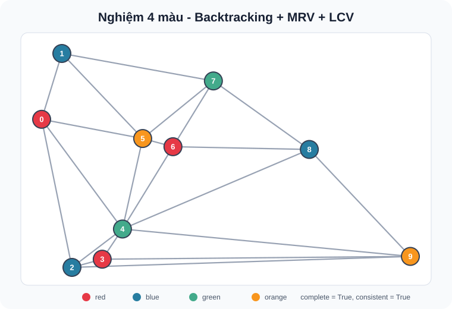
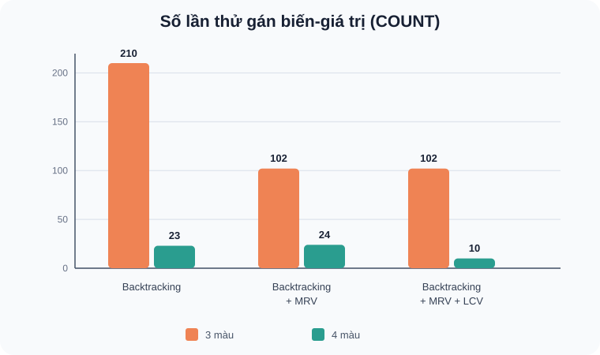
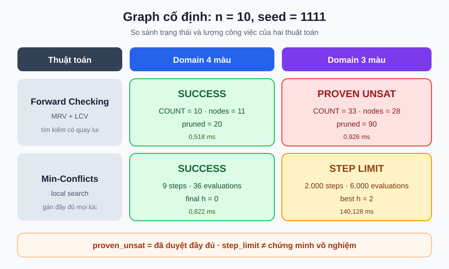

# SƯỜN BÁO CÁO LAB 04 - BÀI TOÁN THỎA MÃN RÀNG BUỘC

> Môn học: Trí tuệ nhân tạo nâng cao  
> Nhóm: [Điền tên nhóm]  
> Thành viên: Hải - Ly - Thiện  
> Giảng viên: [Điền tên giảng viên]  
> Ngày nộp: [dd/mm/yyyy]

---

## Trang thông tin nhóm

| STT | Họ và tên | MSSV | Phạm vi phụ trách chính | Tỷ trọng dự kiến |
|---:|---|---|---|---:|
| 1 | Hải | [Điền MSSV] | Bài 1-4, CSP tô màu đồ thị | 35% |
| 2 | Ly | [Điền MSSV] | Bài 5-7, thuật toán n-Queens | 35% |
| 3 | Thiện | [Điền MSSV] | Bài 8, thí nghiệm tổng hợp, biểu đồ và tích hợp | 30% |

## Tóm tắt báo cáo

[Viết 150-250 từ, trình bày ngắn gọn hai nhóm bài toán, các thuật toán đã cài đặt, cách tổ chức thí nghiệm và những kết quả chính. Không đưa nhận định chưa được dữ liệu thực nghiệm hỗ trợ.]

**Từ khóa:** Constraint Satisfaction Problem, graph coloring, Backtracking, MRV, LCV, Forward Checking, Min-Conflicts, n-Queens, Hill Climbing, Random Restart, Simulated Annealing.

## Danh mục viết tắt

| Viết tắt | Nội dung |
|---|---|
| CSP | Constraint Satisfaction Problem - Bài toán thỏa mãn ràng buộc |
| MRV | Minimum Remaining Values |
| LCV | Least Constraining Value |
| FC | Forward Checking |
| HC | Hill Climbing |
| SA | Simulated Annealing |

## Danh mục bảng và hình

- [Cập nhật số thứ tự và tên bảng sau khi hoàn thiện báo cáo.]
- [Cập nhật số thứ tự và tên hình sau khi hoàn thiện báo cáo.]

---

## Mở đầu

### 1. Bối cảnh và mục tiêu

- Giới thiệu bài toán thỏa mãn ràng buộc và vai trò của tìm kiếm có hệ thống, tìm kiếm cục bộ.
- Nêu hai bài toán được khảo sát: tô màu đồ thị và n-Queens.
- Nêu các tiêu chí đánh giá: tính hợp lệ, số xung đột, `COUNT`/số lần đánh giá, số bước, thời gian, tỷ lệ thành công và khả năng mở rộng.

### 2. Dữ liệu và mã nguồn

- `CSP_graph_coloring_example.ipynb`: Bài 1-4.
- `n_queens.ipynb`: Bài 5-8.
- `README.md`: hướng dẫn chạy và thông tin chung.

### 3. Môi trường thực nghiệm

| Thành phần | Phiên bản/cấu hình |
|---|---|
| Python | [Điền phiên bản] |
| NumPy | [Điền phiên bản] |
| SciPy | [Điền phiên bản] |
| Matplotlib | [Điền phiên bản] |
| Jupyter/Colab | [Điền môi trường] |
| Hệ điều hành/phần cứng | [Điền thông tin] |

### 4. Quy ước đo lường chung

- Dùng seed cố định khi so sánh các thuật toán trên cùng dữ liệu đầu vào; dùng nhiều seed để đánh giá độ ổn định.
- Đo thời gian bằng `time.perf_counter()`; ghi rõ số lượt, điều kiện dừng và cách tính trung bình.
- `COUNT` trong Backtracking là số nút/lần thử theo định nghĩa được ghi trong notebook.
- `evaluations` trong n-Queens là số lần đánh giá hàm `conflicts()`; không so sánh trực tiếp với `COUNT`.
- Chỉ ghi `success = True` khi nghiệm được xác thực độc lập: `complete() and consistent()` đối với tô màu, hoặc `h == 0` đối với n-Queens.
- Hết `max_steps`, `max_attempts` hoặc thời gian chỉ là thất bại trong ngân sách tính toán, không tự động chứng minh bài toán vô nghiệm.

---

# Chương 1. Biểu diễn CSP và sinh đồ thị cần tô màu

**Tương ứng:** Bài 1 trong đề bài.  
**Phụ trách chính:** Hải.  
**Hỗ trợ/review:** Thiện kiểm tra tính tái lập, seed và cách trình bày kết quả.

## 1.1. Mục tiêu chương

Chương này chuẩn bị dữ liệu đầu vào cho các thuật toán ở những chương sau. Công việc chính gồm tạo một graph phẳng có 10 đỉnh, chuyển graph đó thành mô hình CSP và tạo hai phiên bản domain gồm 3 màu và 4 màu.

Sau chương này, mô hình cần trả lời được ba câu hỏi đơn giản:

1. Những đối tượng nào cần được gán màu?
2. Mỗi đối tượng được phép nhận những màu nào?
3. Những cặp đỉnh nào bắt buộc phải khác màu?

## 1.2. Mô hình bài toán

Một bài toán CSP được tạo từ ba thành phần `X`, `D` và `C`. Với bài toán tô màu graph, ba thành phần này được dùng như sau:

| Thành phần | Ý nghĩa trong bài toán | Biểu diễn trong code |
|---|---|---|
| `X` - variables | Các đỉnh cần tô màu, từ 0 đến 9 | `variables = ['0', ..., '9']` |
| `D` - domains | Những màu một đỉnh có thể nhận | `red`, `blue`, `green`, `orange` |
| `C` - constraints | Hai đỉnh có cạnh nối không được cùng màu | Cặp `(i, j)` với `color(i) != color(j)` |

Có thể viết ngắn gọn mô hình như sau:

$$
X = \{0, 1, \ldots, 9\}, \qquad
D_i \in \{\text{red, blue, green, orange}\}, \qquad
C_{ij}: color(i) \ne color(j).
$$

Graph là vô hướng, nên cạnh `(i, j)` và `(j, i)` thực chất là cùng một cạnh. Trong code, nhóm chỉ lưu cặp có `i < j`. Cách này giúp mỗi constraint xuất hiện đúng một lần và tránh kiểm tra trùng.

Hai khái niệm dễ nhầm được phân biệt như sau:

| Khái niệm | Điều kiện | Có chắc là nghiệm không? |
|---|---|---|
| Phép gán đầy đủ | Tất cả 10 đỉnh đều đã có màu | Chưa chắc |
| Phép gán hợp lệ | Các đỉnh kề nhau đều khác màu | Chưa chắc nếu còn đỉnh chưa gán |
| Nghiệm CSP | Vừa đầy đủ, vừa hợp lệ | Có |

Ví dụ, tô tất cả đỉnh bằng `red` là một phép gán đầy đủ nhưng không phải nghiệm, vì nhiều cặp đỉnh kề nhau có cùng màu.

## 1.3. Sinh và mô tả đồ thị

Graph được tạo theo bốn bước ngắn:

1. Cố định `seed = 1111` để có thể tạo lại đúng cùng dữ liệu.
2. Sinh 10 điểm ngẫu nhiên trên mặt phẳng.
3. Dùng Delaunay triangulation để nối các điểm thành một graph phẳng.
4. Từ kết quả Delaunay, lấy danh sách `neighbors` và tập cạnh.

| Thông tin | Giá trị |
|---|---:|
| Số đỉnh | 10 |
| Seed | 1111 |
| Cách nối đỉnh | Delaunay triangulation |
| Số cạnh vô hướng | 21 |
| Bậc trung bình | 4,20 |



> **Hình 1.1.** Graph phẳng được tạo với `n = 10` và seed `1111`. Mỗi đỉnh sẽ trở thành một variable của CSP; mỗi cạnh sẽ tạo một constraint khác màu.

Danh sách `neighbors` cho biết mỗi đỉnh đang nối với những đỉnh nào. Để bảng gọn hơn, danh sách được trình bày thành hai nhóm cột:

| Đỉnh | Neighbors | Đỉnh | Neighbors |
|---:|---|---:|---|
| 0 | 1, 2, 4, 5 | 5 | 0, 1, 4, 6, 7 |
| 1 | 0, 5, 7 | 6 | 4, 5, 7, 8 |
| 2 | 0, 3, 4, 9 | 7 | 1, 5, 6, 8 |
| 3 | 2, 4, 9 | 8 | 4, 6, 7, 9 |
| 4 | 0, 2, 3, 5, 6, 8, 9 | 9 | 2, 3, 4, 8 |

Tổng số phần tử trong các danh sách neighbors là 42. Mỗi cạnh được nhìn thấy từ hai đầu, nên số cạnh thực tế là `42 / 2 = 21`. Kết quả này cũng được kiểm tra tự động trong notebook.

## 1.4. Khảo sát miền 3 màu và 4 màu

Hai cấu hình dùng chung 10 variables và 21 constraints. Phần duy nhất thay đổi là domain của mỗi variable.

| Cấu hình | Domain của một đỉnh | Số phép gán đầy đủ có thể có | Nhận xét |
|---|---|---:|---|
| 4 màu | `red`, `blue`, `green`, `orange` | $4^{10} = 1.048.576$ | Nhiều lựa chọn hơn nên thường dễ tìm màu hợp lệ |
| 3 màu | `red`, `blue`, `green` | $3^{10} = 59.049$ | Ít lựa chọn hơn nhưng constraints chặt hơn; graph có thể không có nghiệm |

Số phép gán trong bảng chỉ là số trường hợp có thể tạo ra trước khi kiểm tra constraints. Phần lớn các phép gán này không hợp lệ. Việc graph có thật sự tô được bằng 3 hoặc 4 màu sẽ được kiểm tra bằng Backtracking và các thuật toán khác ở Chương 3, Chương 4.

Trong code, hai cấu hình được giữ riêng:

```python
csp_4_colors = build_graph_coloring_csp(neighbors, COLORS_4)
csp_3_colors = build_graph_coloring_csp(neighbors, COLORS_3)
```

Mỗi variable nhận một bản sao domain riêng. Chi tiết nhỏ này giúp các bước Forward Checking sau đó có thể tạm xóa màu khỏi một variable mà không làm thay đổi domain của các variable khác.

## 1.5. Kết luận chương

Graph đầu vào đã được chuyển thành một CSP gồm 10 variables, 21 constraints và hai lựa chọn domain. Seed `1111` giúp toàn bộ nhóm dùng đúng cùng một graph khi so sánh thuật toán.

Điểm quan trọng nhất của chương là: **gán đủ màu cho mọi đỉnh chưa có nghĩa là đã tìm được nghiệm**. Kết quả chỉ được chấp nhận khi mọi cặp đỉnh có cạnh nối đều khác màu. Hai điều kiện này sẽ được kiểm tra trực tiếp bằng `complete()` và `consistent()` ở Chương 2.

## 1.6. Phân công và đầu ra

| Thành viên | Công việc | Kết quả |
|---|---|---|
| Hải | Tạo graph, xây dựng `X-D-C`, xuất neighbors và khảo sát domain | Code, bảng số liệu và Hình 1.1 |
| Thiện | Kiểm tra seed, số cạnh và khả năng chạy lại | Xác nhận kết quả có thể tái lập |

Notebook đã chạy lại thành công từ đầu, không dùng đường dẫn cá nhân và tạo đúng 10 đỉnh, 21 cạnh cho seed đã công bố.

---

# Chương 2. Kiểm tra tính đầy đủ và nhất quán

**Tương ứng:** Bài 2 trong đề bài.  
**Phụ trách chính:** Hải.  
**Hỗ trợ/review:** Ly review logic và kết quả các ca kiểm thử.

## 2.1. Mục tiêu chương

Sau khi có mô hình CSP, chương này kiểm tra một assignment đã đủ thông tin và có vi phạm constraint hay chưa. Ba hàm được sử dụng là `complete()`, `consistent()` và `is_solution()`.

Mục tiêu không chỉ là làm cho code chạy, mà còn tránh một lỗi dễ gặp: thuật toán trả về đủ 10 màu nhưng một số đỉnh kề nhau vẫn có cùng màu.

## 2.2. Dữ liệu đầu vào

Một assignment được lưu bằng `dict`. Key là tên đỉnh, value là màu đã gán cho đỉnh đó.

```python
assignment = {'0': 'red', '1': 'blue'}
```

Ví dụ trên mới gán màu cho đỉnh 0 và 1, nên đây là assignment từng phần. Ba thành phần của `csp` được dùng khi kiểm tra gồm:

| Thành phần | Dùng để kiểm tra |
|---|---|
| `variables` | Assignment đã có đủ các đỉnh hay chưa |
| `domains` | Màu được gán có nằm trong domain của đỉnh hay không |
| `constraints` | Hai đỉnh nối với nhau có bị cùng màu hay không |

## 2.3. Các hàm kiểm tra

| Hàm | Trả về `True` khi | Không kiểm tra |
|---|---|---|
| `complete()` | Tập key của assignment đúng bằng tập variables | Màu có hợp lệ hay không |
| `consistent()` | Màu thuộc domain và các constraint đã xét đều được thỏa | Assignment đã đủ tất cả variables hay chưa |
| `is_solution()` | Cả `complete()` và `consistent()` đều đúng | - |

Phần kết hợp cuối cùng khá ngắn:

```python
def is_solution(assignment, csp):
    return complete(assignment, csp) and consistent(assignment, csp)
```

`consistent()` chỉ kiểm tra những constraint có cả hai đầu đã được gán. Vì vậy, assignment rỗng hoặc assignment từng phần vẫn có thể nhất quán: tại thời điểm đó chưa có constraint nào bị vi phạm.



> **Hình 2.1.** Bốn trường hợp có thể xảy ra khi kết hợp `complete()` và `consistent()`. Chỉ ô màu xanh là nghiệm CSP.

## 2.4. Kiểm thử

Notebook sử dụng sáu test case. Mỗi test đều ghi trước expected result, sau đó so sánh với actual result và dùng `assert` để dừng chương trình nếu có sai khác.

Trong bảng dưới, `C` là `complete`, `K` là `consistent` và `S` là `is_solution`.

| STT | Test case | Expected `(C, K, S)` | Actual `(C, K, S)` | Kết quả |
|---:|---|---|---|---|
| 1 | Assignment rỗng `{}` | `(False, True, False)` | `(False, True, False)` | PASS |
| 2 | Gán một phần: `0=red`, `1=blue` | `(False, True, False)` | `(False, True, False)` | PASS |
| 3 | Hai đỉnh kề cùng màu: `0=red`, `1=red` | `(False, False, False)` | `(False, False, False)` | PASS |
| 4 | Màu ngoài domain: `0=purple` | `(False, False, False)` | `(False, False, False)` | PASS |
| 5 | Gán đủ nhưng tất cả đỉnh đều màu `red` | `(True, False, False)` | `(True, False, False)` | PASS |
| 6 | Assignment đầy đủ và hợp lệ | `(True, True, True)` | `(True, True, True)` | PASS |

Kết quả đạt **6/6 test case**. Ngoài nghiệm mẫu, notebook còn kiểm tra trực tiếp assignment do Backtracking tạo ra:

| Kiểm tra nghiệm Backtracking | Kết quả |
|---|---|
| `complete(res, csp)` | `True` |
| `consistent(res, csp)` | `True` |
| `is_solution(res, csp)` | `True` |

## 2.5. Trả lời câu hỏi thảo luận

`complete()` và `consistent()` kiểm tra hai việc khác nhau. `complete()` chỉ quan tâm đã gán đủ variables hay chưa, còn `consistent()` quan tâm các giá trị đang có có hợp lệ hay không. Vì vậy, một assignment đầy đủ không tự động trở thành nghiệm CSP.

Ví dụ rõ nhất là gán toàn bộ đỉnh bằng `red`: assignment có đủ 10 đỉnh nên `complete()` trả về `True`, nhưng các đỉnh kề nhau bị trùng màu nên `consistent()` trả về `False`.

Việc kiểm tra lại nghiệm bằng hàm độc lập cũng rất cần thiết. Trạng thái `success` của thuật toán chỉ được chấp nhận khi `is_solution()` trả về `True`; nhờ đó lỗi trong quá trình search không bị ghi nhầm thành kết quả đúng.

## 2.6. Kết luận chương

Ba hàm kiểm tra đã phân biệt rõ assignment từng phần, assignment đầy đủ và nghiệm CSP. Toàn bộ sáu test case đều đúng với expected result, đồng thời nghiệm do Backtracking sinh ra cũng vượt qua bước xác thực độc lập.

## 2.7. Phân công và đầu ra

| Thành viên | Công việc | Kết quả |
|---|---|---|
| Hải | Hoàn thiện ba hàm kiểm tra, chuẩn bị test và chạy expected/actual | 6/6 test PASS |
| Ly | Review các trường hợp từng phần, xung đột và màu ngoài domain | Logic kiểm tra được xác nhận |

Các test chạy được từ kernel sạch và kết quả đã được lưu trong notebook.

---

# Chương 3. Backtracking Search và thứ tự chọn biến/giá trị

**Tương ứng:** Bài 3 trong đề bài.  
**Phụ trách chính:** Hải.  
**Hỗ trợ/review:** Thiện kiểm tra quy ước `COUNT`, thời gian và tính công bằng của so sánh.

## 3.1. Mục tiêu chương

Chương này dùng Backtracking để tìm cách tô màu hợp lệ cho graph ở Chương 1. Sau phiên bản cơ bản, hai cách sắp thứ tự được thêm vào để giảm những lựa chọn không cần thiết:

| Cấu hình | Chọn variable | Chọn màu |
|---|---|---|
| Backtracking | Variable chưa gán đầu tiên | Theo thứ tự trong domain |
| Backtracking + MRV | Variable còn ít màu hợp lệ nhất | Theo thứ tự trong domain |
| Backtracking + MRV + LCV | Variable còn ít màu hợp lệ nhất | Màu ít gây khó cho neighbors nhất |

## 3.2. Backtracking cơ bản

Backtracking tô từng đỉnh theo thứ tự. Nếu màu vừa thử làm assignment vi phạm constraint, thuật toán bỏ màu đó và thử màu tiếp theo. Khi một variable không còn màu phù hợp, thuật toán quay lại variable trước để đổi lựa chọn.

| Bước | Xử lý |
|---:|---|
| 1 | Kiểm tra assignment đã đầy đủ chưa |
| 2 | Chọn một variable chưa gán |
| 3 | Thử từng màu trong domain |
| 4 | Nếu assignment vẫn nhất quán, tiếp tục sang variable kế tiếp |
| 5 | Nếu nhánh thất bại, xóa phép gán vừa thử và quay lui |

Trong notebook, `COUNT` là **số lần thử một cặp variable-color**. Ví dụ, thử `đỉnh 4 = red` làm `COUNT` tăng một đơn vị, dù màu đó bị loại ngay. Chỉ số `nodes` là số trạng thái từng phần đã được mở rộng, bao gồm nút gốc và nút nghiệm.

Thuật toán dừng khi tìm được assignment thỏa `is_solution()`, hoặc khi đã thử hết mọi khả năng. Vì đây là Backtracking đầy đủ trên CSP hữu hạn, trường hợp thử hết mà không có nghiệm có thể dùng để kết luận graph không tô được với domain đang xét.

## 3.3. Minimum Remaining Values

MRV chọn variable đang có ít màu hợp lệ nhất. Ý tưởng đơn giản là xử lý chỗ khó trước: nếu một đỉnh gần như hết lựa chọn, ta nên phát hiện sớm thay vì tiếp tục tô những đỉnh dễ.

Số màu của MRV được tính sau khi bỏ những màu đã được neighbors sử dụng, không chỉ lấy độ dài domain ban đầu. Với assignment mẫu:

```python
{'0': 'red', '1': 'blue'}
```

Backtracking cơ bản chọn đỉnh 2 vì đây là variable chưa gán đầu tiên. MRV chọn đỉnh 5 vì tại thời điểm đó đỉnh 5 còn ít màu hợp lệ hơn. Nếu nhiều variable có cùng điểm MRV, notebook giữ thứ tự variable ban đầu để kết quả có thể chạy lại giống nhau.

## 3.4. Least Constraining Value

Sau khi MRV chọn variable, LCV quyết định màu nào được thử trước. Mỗi màu được chấm bằng số lựa chọn mà nó sẽ loại khỏi domain của các neighbors chưa gán.

| Điểm LCV | Ý nghĩa | Thứ tự thử |
|---:|---|---|
| Nhỏ | Ít làm giảm lựa chọn của neighbors | Thử trước |
| Lớn | Làm nhiều neighbors mất màu | Thử sau |
| Không hợp lệ ngay | Trùng màu với neighbor đã gán | Đưa xuống cuối |

Nếu hai màu có cùng điểm, thứ tự màu gốc `red`, `blue`, `green`, `orange` được dùng để phá hòa. LCV chỉ đổi thứ tự thử; nó không xóa nghiệm khỏi không gian tìm kiếm.

## 3.5. Thiết kế thí nghiệm

Để so sánh công bằng, ba cấu hình dùng đúng cùng dữ liệu:

| Thông tin | Giá trị |
|---|---|
| Số đỉnh / cạnh | 10 / 21 |
| Seed | 1111 |
| Domain | 3 màu và 4 màu |
| Thứ tự màu | Giữ cố định |
| Đo thời gian | `time.perf_counter()` |
| Kiểm tra nghiệm | `is_solution()` |

Kết quả một lần chạy đầy đủ của notebook:

| Domain | Thuật toán | Thành công | `COUNT` | Nodes | Thời gian (ms) |
|---|---|---:|---:|---:|---:|
| 4 màu | Backtracking | Có | 23 | 11 | 0,411 |
| 4 màu | Backtracking + MRV | Có | 24 | 11 | 0,561 |
| 4 màu | Backtracking + MRV + LCV | Có | 10 | 11 | 1,631 |
| 3 màu | Backtracking | Không | 210 | 70 | 1,991 |
| 3 màu | Backtracking + MRV | Không | 102 | 34 | 1,654 |
| 3 màu | Backtracking + MRV + LCV | Không | 102 | 34 | 2,896 |

Thời gian ở đây rất nhỏ và có thể dao động giữa các lần chạy. Vì vậy, `COUNT` và `nodes` được dùng làm chỉ số chính; thời gian chỉ đóng vai trò tham khảo.

## 3.6. Kết quả trực quan và nhận xét



> **Hình 3.1.** Nghiệm 4 màu do Backtracking + MRV + LCV tìm được. Nghiệm có `complete = True` và `consistent = True`.



> **Hình 3.2.** So sánh số lần thử gán giữa ba cấu hình. Cột thấp hơn cho biết thuật toán thử ít cặp variable-color hơn.

Với domain 4 màu, cả ba cấu hình đều tìm được nghiệm sau 11 nodes. LCV giảm `COUNT` từ 23 xuống 10, tương đương khoảng 56,5%. Tuy nhiên thời gian lại cao hơn vì mỗi màu phải được chấm điểm trước khi thử. MRV dùng một mình không cải thiện trường hợp này và `COUNT` tăng nhẹ từ 23 lên 24.

Với domain 3 màu, cả ba cấu hình đều duyệt hết phần tìm kiếm cần thiết và không tìm thấy nghiệm. MRV giảm `COUNT` từ 210 xuống 102 và giảm nodes từ 70 xuống 34, tương đương khoảng 51,4%. LCV không giảm thêm số lần thử trong trường hợp này, nhưng vẫn tốn thời gian để tính thứ tự màu.

Kết quả cho thấy heuristic giúp thay đổi hình dạng cây search chứ không bảo đảm luôn chạy nhanh hơn. Với graph nhỏ hoặc nghiệm dễ gặp, chi phí tính MRV/LCV có thể lớn hơn phần công việc tiết kiệm được.

### Tác động của MRV lên cây Backtracking

MRV thường làm cây hẹp hơn vì nhánh khó được xử lý sớm. Nếu variable ít lựa chọn dẫn đến thất bại, thuật toán quay lui ngay thay vì phát hiện lỗi ở gần cuối. Đổi lại, tại mỗi node phải tính số màu hợp lệ của các variable chưa gán; đây là phần chi phí tăng thêm.

## 3.7. Kết luận chương

Backtracking cơ bản, MRV và LCV đều được cài trên cùng một lõi tìm kiếm. Với graph 4 màu, MRV + LCV dùng ít lần thử nhất và trả về nghiệm hợp lệ. Với graph 3 màu, MRV giảm khoảng một nửa `COUNT` và nodes so với baseline.

Kết quả chỉ phản ánh graph `n = 10`, seed `1111`. Không nên kết luận một heuristic luôn tốt nhất chỉ từ một graph; thí nghiệm nhiều kích thước và seed được tiếp tục ở Chương 4.

## 3.8. Phân công và đầu ra

| Thành viên | Công việc | Kết quả |
|---|---|---|
| Hải | Giữ baseline, cài MRV/LCV, chạy so sánh và vẽ nghiệm | Ba cấu hình, bảng kết quả và Hình 3.1 |
| Thiện | Review `COUNT`, cách đo thời gian và đầu vào chung | Xác nhận phép so sánh dùng cùng graph/seed |

Mọi kết quả báo thành công đều được kiểm tra lại bằng `is_solution()` trước khi đưa vào bảng.

---

# Chương 4. Forward Checking và Min-Conflicts

**Tương ứng:** Bài 4 trong đề bài.  
**Phụ trách chính:** Hải.  
**Hỗ trợ/review:** Thiện thống nhất schema dữ liệu và cấu hình thí nghiệm tổng hợp.

## 4.1. Mục tiêu chương

Chương này mở rộng thuật toán ở Chương 3 theo hai hướng khác nhau. Forward Checking vẫn dùng Backtracking nhưng kiểm tra trước domain của các đỉnh chưa tô. Min-Conflicts đi theo hướng local search: luôn giữ một phép gán đầy đủ rồi sửa dần các vị trí đang xung đột.

Hai thuật toán được đánh giá trên cùng graph để trả lời ba câu hỏi:

- Forward Checking giúp phát hiện nhánh sai sớm như thế nào?
- Min-Conflicts có tìm được nghiệm trong giới hạn bước hay không?
- Khi domain giảm từ 4 màu xuống 3 màu, kết quả thay đổi ra sao?

## 4.2. Forward Checking

Mỗi đỉnh có một domain riêng, ban đầu chứa toàn bộ màu được phép dùng. Sau khi gán màu cho một đỉnh, Forward Checking xóa màu đó khỏi domain của các neighbors chưa được gán. Nếu một domain trở thành rỗng, nhánh hiện tại chắc chắn không thể hoàn thành và được dừng ngay.

| Bước | Xử lý |
|---:|---|
| 1 | Chọn variable bằng MRV và sắp xếp màu bằng LCV. |
| 2 | Thử một màu không xung đột với assignment hiện tại. |
| 3 | Xóa màu vừa chọn khỏi domain của các neighbors chưa gán. |
| 4 | Nếu có domain rỗng, dừng nhánh và backtrack. |
| 5 | Khi backtrack, trả lại đúng các màu đã bị xóa ở bước 3. |

Phần hoàn tác domain là điểm quan trọng nhất. Mỗi lần xóa màu, chương trình lưu lại variable, màu và vị trí cũ. Khi nhánh thất bại, các thay đổi này được phục hồi theo thứ tự ngược. Nhờ vậy, thử nghiệm của một nhánh không làm sai domain của nhánh tiếp theo.

Các chỉ số được ghi lại gồm:

| Chỉ số | Ý nghĩa |
|---|---|
| `COUNT` | Số lần thử một cặp variable-color. |
| `nodes` | Số trạng thái được mở trong cây search. |
| `pruned` | Số lần một màu bị loại khỏi domain nhờ Forward Checking. |
| `status` | `success`, `proven_unsat` hoặc `node_limit`. |

`proven_unsat` chỉ được dùng khi thuật toán đã duyệt đầy đủ phần tìm kiếm cần thiết mà không gặp `node_limit`. Nếu bị dừng do giới hạn node, kết quả chưa đủ để kết luận vô nghiệm.

## 4.3. Min-Conflicts

Min-Conflicts không xây assignment từ rỗng như Backtracking. Thuật toán gán màu cho toàn bộ đỉnh ngay từ đầu, sau đó lặp lại việc giảm số cạnh có hai đầu cùng màu.

```text
Khởi tạo một assignment đầy đủ
Lặp tối đa max_steps lần:
    nếu không còn cạnh xung đột: trả về nghiệm
    chọn ngẫu nhiên một đỉnh đang xung đột
    thử các màu và tính số xung đột tạo ra
    chọn một màu có số xung đột nhỏ nhất
Kết thúc giới hạn: trả về step_limit
```

Khi nhiều màu có cùng điểm tốt nhất, một màu được chọn ngẫu nhiên. Seed của bộ sinh số ngẫu nhiên được cố định để có thể chạy lại thí nghiệm. Notebook ghi số `steps`, số lần đánh giá màu, `final h`, `best h`, lịch sử xung đột và thời gian chạy. Trong đó, `h` là số cạnh đang vi phạm ràng buộc; `h = 0` nghĩa là đã tìm được nghiệm.

Min-Conflicts có thể bị lặp quanh một vùng chưa tốt hoặc hết số bước trước khi gặp nghiệm. Vì vậy, trạng thái `step_limit` chỉ có nghĩa là **chưa tìm được nghiệm trong giới hạn đã đặt**, không phải là chứng minh bài toán vô nghiệm.

## 4.4. Kết quả trên graph cố định

Thử nghiệm đầu tiên dùng graph Delaunay có 10 đỉnh, 21 cạnh và seed `1111`, giống dữ liệu ở các chương trước.

| Thuật toán | Domain | Trạng thái | Lượng công việc | Kết quả phụ | Thời gian (ms) |
|---|---:|---|---:|---:|---:|
| Forward Checking | 4 màu | `success` | `COUNT = 10`, nodes = 11 | pruned = 20 | 0,518 |
| Forward Checking | 3 màu | `proven_unsat` | `COUNT = 33`, nodes = 28 | pruned = 90 | 0,926 |
| Min-Conflicts | 4 màu | `success` | 9 steps | 36 evaluations, `h = 0` | 0,822 |
| Min-Conflicts | 3 màu | `step_limit` | 2.000 steps | 6.000 evaluations, best `h = 2` | 140,128 |



> **Hình 4.1.** Trạng thái của hai thuật toán trên cùng graph. `proven_unsat` và `step_limit` mang hai ý nghĩa khác nhau.

Với 4 màu, cả hai thuật toán đều tìm được nghiệm nhanh. Với 3 màu, Forward Checking hoàn tất search và chứng minh graph không thể tô hợp lệ, còn Min-Conflicts dừng sau 2.000 bước với kết quả tốt nhất vẫn còn 2 cạnh xung đột.

## 4.5. Thiết kế benchmark

Để tránh kết luận từ một graph duy nhất, notebook tiếp tục chạy trên nhiều kích thước và seed. Với mỗi bộ `(n, seed, số màu)`, hai thuật toán nhận đúng cùng một graph.

| Thành phần | Cấu hình |
|---|---|
| Kích thước graph | `n = 10, 20, 30` |
| Seed tạo graph | `1111, 2222, 3333` |
| Domain | 3 màu và 4 màu |
| Thuật toán | Forward Checking + MRV + LCV; Min-Conflicts |
| Giới hạn Forward Checking | `max_nodes = 50.000` |
| Giới hạn Min-Conflicts | `max_steps = 3.000` |
| Tổng số lượt | 36 lượt |

Mỗi dòng trong bảng sau là trung bình của 3 seed. `Effort` là `COUNT` đối với Forward Checking và là số bước đối với Min-Conflicts. Hai đại lượng này mô tả lượng công việc riêng của từng thuật toán, không nên xem là cùng một phép đo tuyệt đối.

| Thuật toán | `n` | Màu | Cạnh TB | Thành công | Effort TB | Best `h` TB | Thời gian TB (ms) | Trạng thái |
|---|---:|---:|---:|---:|---:|---:|---:|---|
| Forward Checking | 10 | 3 | 20,7 | 0% | 31,0 | — | 0,916 | `proven_unsat: 3` |
| Forward Checking | 10 | 4 | 20,7 | 100% | 10,0 | 0,00 | 0,407 | `success: 3` |
| Forward Checking | 20 | 3 | 50,3 | 0% | 37,0 | — | 1,386 | `proven_unsat: 3` |
| Forward Checking | 20 | 4 | 50,3 | 100% | 20,0 | 0,00 | 1,265 | `success: 3` |
| Forward Checking | 30 | 3 | 78,7 | 0% | 51,0 | — | 2,757 | `proven_unsat: 3` |
| Forward Checking | 30 | 4 | 78,7 | 100% | 37,7 | 0,00 | 3,020 | `success: 3` |
| Min-Conflicts | 10 | 3 | 20,7 | 0% | 3.000,0 | 1,33 | 189,169 | `step_limit: 3` |
| Min-Conflicts | 10 | 4 | 20,7 | 100% | 5,3 | 0,00 | 0,419 | `success: 3` |
| Min-Conflicts | 20 | 3 | 50,3 | 0% | 3.000,0 | 3,67 | 328,774 | `step_limit: 3` |
| Min-Conflicts | 20 | 4 | 50,3 | 100% | 44,0 | 0,00 | 5,102 | `success: 3` |
| Min-Conflicts | 30 | 3 | 78,7 | 0% | 3.000,0 | 5,67 | 457,161 | `step_limit: 3` |
| Min-Conflicts | 30 | 4 | 78,7 | 100% | 109,7 | 0,00 | 16,766 | `success: 3` |

## 4.6. Phân tích kết quả

### Tác động của Forward Checking

Forward Checking loại sớm các màu không còn dùng được. Khi một neighbor mất hết màu, thuật toán quay lui ngay mà không cần chờ đến lúc chọn neighbor đó. Cách này thường làm cây search nhỏ hơn, nhất là ở các bài có nhiều ràng buộc.

Chi phí thêm vào là phải sao chép hoặc cập nhật domain, ghi nhận các màu bị xóa và hoàn tác chính xác khi backtrack. Vì vậy, Forward Checking không phải lúc nào cũng nhanh hơn trên graph rất nhỏ. Trong benchmark này, chi phí đó vẫn thấp: thời gian trung bình lớn nhất chỉ khoảng 3,020 ms.

### Khác biệt giữa 3 màu và 4 màu

Ở cả 9 graph dùng 4 màu, hai thuật toán đều đạt tỷ lệ thành công 100%. Khi `n` tăng, Min-Conflicts cần nhiều bước hơn, từ trung bình 5,3 bước ở `n = 10` lên 109,7 bước ở `n = 30`, nhưng vẫn tìm được nghiệm trong giới hạn.

Với 3 màu, Forward Checking trả về `proven_unsat` cho cả 9 graph. Min-Conflicts đều chạm giới hạn 3.000 bước; best `h` tăng từ 1,33 lên 5,67 khi kích thước graph tăng. Điều này cho thấy thuật toán đã tiến gần một lời giải tốt nhưng không thể loại hết xung đột. Kết quả của Forward Checking mới là cơ sở để kết luận các graph 3 màu đã thử là vô nghiệm.

### Cách đọc trạng thái kết quả

| Trạng thái | Có nghiệm? | Có chứng minh vô nghiệm? | Cách hiểu |
|---|---:|---:|---|
| `success` | Có | Không cần | Assignment đầy đủ và đã qua `is_solution()`. |
| `step_limit` | Chưa tìm thấy | Không | Min-Conflicts đã dùng hết số bước cho phép. |
| `node_limit` | Chưa tìm thấy | Không | Backtracking bị dừng trước khi duyệt xong. |
| `proven_unsat` | Không | Có | Backtracking đã duyệt đầy đủ mà không có nghiệm. |

Benchmark chỉ dùng 3 seed cho mỗi cấu hình, nên kết quả phù hợp để minh họa hoạt động của thuật toán nhưng chưa đủ để khẳng định hiệu năng cho mọi graph Delaunay.

## 4.7. Kết luận chương

Forward Checking có ưu điểm là phát hiện ngõ cụt sớm và có thể chứng minh vô nghiệm khi hoàn tất search. Đổi lại, thuật toán phải quản lý và hoàn tác domain cẩn thận. Min-Conflicts đơn giản, tìm nghiệm 4 màu nhanh trên các graph đã thử và phù hợp khi cần một lời giải tốt trong thời gian ngắn. Điểm hạn chế là hết bước không cho biết bài toán thật sự vô nghiệm hay chỉ chưa gặp nghiệm.

Trong 36 lượt benchmark, cả hai thuật toán giải thành công toàn bộ 18 lượt dùng 4 màu. Với 18 lượt dùng 3 màu, Forward Checking chứng minh vô nghiệm, còn Min-Conflicts đều dừng ở `step_limit`. Kết quả này cũng cho thấy trạng thái dừng cần được báo rõ bên cạnh thời gian và số bước.

## 4.8. Phân công và đầu ra

| Thành viên | Công việc | Kết quả |
|---|---|---|
| Hải | Cài Forward Checking và hoàn tác domain; cài Min-Conflicts; chạy nhiều `n`, seed và domain 3/4 màu | Hai thuật toán, dữ liệu graph cố định và 36 lượt benchmark |
| Thiện | Thống nhất tên cột/chỉ số; kiểm tra dữ liệu phục vụ tổng hợp; review tính công bằng | Hai thuật toán dùng cùng graph trong từng cấu hình, trạng thái dừng được ghi rõ |

Các nghiệm báo `success` đều được kiểm tra lại bằng `is_solution()`. Domain của Forward Checking cũng được phục hồi sau mỗi lần backtrack để các nhánh search độc lập với nhau.

---

# Chương 5. Biểu diễn bài toán n-Queens

**Tương ứng:** Bài 5 trong đề bài.  
**Phụ trách chính:** Ly.  
**Hỗ trợ/review:** Hải kiểm tra logic đếm xung đột.

## 5.1. Mục tiêu chương

- Trình bày cách biểu diễn một trạng thái n-Queens.
- Định nghĩa hàm mục tiêu `h(board)`.
- Kiểm tra các ví dụ `n = 4`, `n = 8` và trực quan hóa bàn cờ.

## 5.2. Biểu diễn trạng thái

- `board[i]` là chỉ số hàng của quân hậu tại cột `i`.
- Mỗi cột luôn có đúng một quân hậu.
- Không gian trạng thái và kiểu dữ liệu được sử dụng.

## 5.3. Hàm đánh giá xung đột

- `h(board)` là số cặp quân hậu cùng hàng hoặc cùng đường chéo.
- Nêu công thức/điều kiện kiểm tra xung đột của cặp cột `i`, `j`.
- Giải thích vì sao `h = 0` khi và chỉ khi không có cặp quân hậu tấn công nhau trong biểu diễn này.

## 5.4. Kiểm thử và trực quan hóa

| Bàn cờ | `n` | `h(board)` mong đợi | Kết quả thực tế | Nhận xét |
|---|---:|---:|---:|---|
| `[1, 3, 0, 2]` | 4 | 0 | [Điền] | Nghiệm hợp lệ |
| `[Điền bàn cờ]` | 4 | [Điền] | [Điền] | [Điền] |
| `[Điền bàn cờ]` | 8 | [Điền] | [Điền] | [Điền] |

> **Hình 5.1.** Bàn cờ n-Queens với `n = [điền]`, `h = [điền]`.

## 5.5. Kết luận chương

[Tóm tắt ưu điểm của biểu diễn một quân hậu trên mỗi cột và vai trò của `h(board)`.]

## 5.6. Phân công và đầu ra

- **Ly:** giải thích trạng thái; định nghĩa/kiểm thử `h(board)`; tạo ví dụ `n = 4, 8`; chèn hình bàn cờ.
- **Hải:** review cách đếm mỗi cặp xung đột đúng một lần và các trường hợp cùng hàng/đường chéo.
- **Đầu ra bắt buộc:** giải thích `board[i]`; định nghĩa `h`; kiểm tra `[1, 3, 0, 2]`; ví dụ `n = 4, 8`; ít nhất một hình bàn cờ.
- **Tiêu chí hoàn thành:** hàm xung đột cho kết quả đúng trên các test đã biết và hình khớp với dữ liệu bàn cờ.

---

# Chương 6. Các biến thể Hill Climbing

**Tương ứng:** Bài 6 trong đề bài.  
**Phụ trách chính:** Ly.  
**Hỗ trợ/review:** Thiện kiểm tra quy ước metrics và lịch sử hội tụ.

## 6.1. Mục tiêu chương

- Cài đặt Steepest-ascent Hill Climbing.
- Cài đặt Inefficient Stochastic Hill Climbing.
- Cài đặt Efficient Stochastic/First-choice Hill Climbing.
- So sánh số bước, số lần đánh giá và khả năng mắc kẹt.

## 6.2. Không gian lân cận và điều kiện dừng

- Định nghĩa một nước đi lân cận: `[mô tả toán tử đổi hàng của một quân hậu]`.
- Nêu cách sinh/duyệt láng giềng.
- Nêu điều kiện thành công, local optimum, plateau, `max_steps` và `max_attempts`.

## 6.3. Steepest-ascent Hill Climbing

- Đánh giá toàn bộ láng giềng.
- Chọn nước đi cải thiện tốt nhất.
- Dừng khi không còn cải thiện.
- Trình bày giả mã và độ lớn lân cận.

## 6.4. Inefficient Stochastic Hill Climbing

- Liệt kê toàn bộ các nước đi cải thiện.
- Chọn ngẫu nhiên một nước đi trong danh sách.
- Trình bày ảnh hưởng đến số lần đánh giá.

## 6.5. Efficient Stochastic/First-choice Hill Climbing

- Sinh từng láng giềng ngẫu nhiên.
- Chấp nhận nước đi đầu tiên cải thiện.
- Nêu rõ giới hạn thử để tránh lặp vô hạn trên plateau.

## 6.6. Giao diện kết quả và quy ước metrics

Mỗi thuật toán trả về tối thiểu:

```python
{
    "board": [...],
    "final_conflicts": 0,
    "success": True,
    "steps": 12,
    "evaluations": 120,
    "history": [7, 5, 3, 1, 0],
}
```

- Định nghĩa `steps` và `evaluations` thống nhất giữa ba biến thể.
- Mọi lần gọi `conflicts()` để chấm một trạng thái phải được tính vào `evaluations`.

## 6.7. Kết quả thử nghiệm ban đầu

| Thuật toán | `n` | Seed | Thành công | Xung đột cuối | Số bước | Số lần đánh giá | Thời gian (s) |
|---|---:|---:|---:|---:|---:|---:|---:|
| Steepest HC | [Điền] | [Điền] | [Điền] | [Điền] | [Điền] | [Điền] | [Điền] |
| Inefficient Stochastic HC | [Điền] | [Điền] | [Điền] | [Điền] | [Điền] | [Điền] | [Điền] |
| Efficient Stochastic HC | [Điền] | [Điền] | [Điền] | [Điền] | [Điền] | [Điền] | [Điền] |

## 6.8. Thảo luận

- So sánh ba biến thể về cách chọn nước đi và số lần đánh giá láng giềng.
- Phân tích local optimum và plateau quan sát được.
- Trả lời câu hỏi 5 của đề.

## 6.9. Kết luận chương

[Tóm tắt đánh đổi giữa chất lượng nghiệm và chi phí đánh giá của ba biến thể.]

## 6.10. Phân công và đầu ra

- **Ly:** cài ba biến thể; định nghĩa điều kiện dừng; ghi đủ metrics/history; viết phần so sánh.
- **Thiện:** review cách đếm `evaluations`, định dạng kết quả và khả năng sử dụng lịch sử cho biểu đồ Chương 8.
- **Đầu ra bắt buộc:** ba thuật toán; metrics thống nhất; bảng thử nghiệm; trả lời câu hỏi 5.
- **Tiêu chí hoàn thành:** không có vòng lặp vô hạn; cùng quy ước đo giữa ba biến thể; chạy được với seed truyền vào.

---

# Chương 7. Random Restart và Simulated Annealing

**Tương ứng:** Bài 7 trong đề bài.  
**Phụ trách chính:** Ly.  
**Hỗ trợ/review:** Thiện kiểm tra tính công bằng của so sánh và tham số thí nghiệm.

## 7.1. Mục tiêu chương

- Bổ sung Random Restart cho ba biến thể Hill Climbing.
- Cài đặt Simulated Annealing với ít nhất hai lịch làm nguội.
- Đánh giá cách các phương pháp thoát local optimum/plateau.

## 7.2. Random Restart

- Khởi tạo lại bàn cờ ngẫu nhiên và chạy thuật toán cơ sở.
- Giới hạn tối đa 100 lần khởi động lại.
- Dừng sớm khi `h = 0`.
- Ghi số restart, tổng số bước, tổng số lần đánh giá, thời gian và nghiệm tốt nhất.

## 7.3. Simulated Annealing

- Định nghĩa `delta_h` và xác suất chấp nhận nước đi tệ hơn: `p = exp(-delta_h / T)` khi `delta_h > 0`.
- Nêu nhiệt độ ban đầu, nhiệt độ tối thiểu và giới hạn vòng lặp.
- Lưu cả trạng thái cuối và trạng thái tốt nhất đã gặp.

### 7.3.1. Lịch làm nguội 1 - Geometric

[Nêu công thức, tham số và lý do chọn.]

### 7.3.2. Lịch làm nguội 2 - Inverse hoặc logarithmic

[Nêu công thức, tham số và lý do chọn.]

## 7.4. Thiết kế so sánh

- Dùng cùng `n`, tập seed/bàn cờ đầu vào và ngân sách tính toán khi hợp lý.
- Phân biệt `success` (`h = 0`) với nghiệm tốt nhất (`h` nhỏ nhất).
- Ghi rõ cách cộng chi phí qua các lần restart.

| Thuật toán | `n` | Số lượt | Giới hạn | Tỷ lệ thành công | Xung đột cuối TB | Bước TB | Đánh giá TB | Thời gian TB (s) |
|---|---:|---:|---|---:|---:|---:|---:|---:|
| Random Restart + Steepest | [Điền] | [Điền] | 100 restart | [Điền] | [Điền] | [Điền] | [Điền] | [Điền] |
| Random Restart + Inefficient Stochastic | [Điền] | [Điền] | 100 restart | [Điền] | [Điền] | [Điền] | [Điền] | [Điền] |
| Random Restart + Efficient Stochastic | [Điền] | [Điền] | 100 restart | [Điền] | [Điền] | [Điền] | [Điền] | [Điền] |
| SA - lịch 1 | [Điền] | [Điền] | [Điền] | [Điền] | [Điền] | [Điền] | [Điền] | [Điền] |
| SA - lịch 2 | [Điền] | [Điền] | [Điền] | [Điền] | [Điền] | [Điền] | [Điền] | [Điền] |

## 7.5. Thảo luận

- Mô tả biểu hiện của local optimum/plateau trong Hill Climbing.
- Giải thích Random Restart xử lý bằng đa dạng hóa trạng thái khởi tạo.
- Giải thích Simulated Annealing có thể thoát bẫy nhờ chấp nhận có kiểm soát nước đi tệ hơn.
- Trả lời câu hỏi 4 của đề.

## 7.6. Kết luận chương

[So sánh hiệu quả, chi phí và độ nhạy tham số của Random Restart và Simulated Annealing.]

## 7.7. Phân công và đầu ra

- **Ly:** cài wrapper Random Restart cho ba HC; cài SA và hai lịch làm nguội; xuất nghiệm cuối/best-so-far cùng metrics/history.
- **Thiện:** review cách dùng seed, điều kiện dừng, ngân sách so sánh và dữ liệu bàn giao cho Chương 8.
- **Đầu ra bắt buộc:** Random Restart tối đa 100 lần; SA với ít nhất hai lịch; bảng kết quả; trả lời câu hỏi 4.
- **Tiêu chí hoàn thành:** phép đo cộng dồn đúng qua restart; SA giữ được nghiệm tốt nhất; mọi cấu hình có điều kiện dừng hữu hạn.

---

# Chương 8. Đánh giá tổng hợp và bài nâng cao

**Tương ứng:** Bài 8 trong đề bài.  
**Phụ trách chính:** Thiện.  
**Hỗ trợ:** Hải cung cấp dữ liệu tô màu; Ly cung cấp API, log và dữ liệu n-Queens.  
**Review:** Hải review phần tô màu và câu hỏi 1-3; Ly review phần n-Queens và câu hỏi 4-5; Thiện biên tập toàn bộ.

## 8.1. Mục tiêu chương

- Tổng hợp và đánh giá các thuật toán bằng một quy trình thực nghiệm tái lập được.
- Chạy tối thiểu 100 lượt cho mỗi thiết lập n-Queens tại `n = 4` và `n = 8`.
- Vẽ biểu đồ hội tụ tại `n = 8`.
- Vẽ biểu đồ log-log thời gian theo `n in {4, 8, 12, 16, 20}` cho ít nhất hai thuật toán.
- Tổng hợp thí nghiệm tô màu với 3/4 màu, nhiều kích thước và nhiều seed.

## 8.2. Thiết kế benchmark

- Danh sách thuật toán: `[điền đầy đủ]`.
- Danh sách kích thước, seed, số lượt và điều kiện dừng.
- Cách tạo bàn cờ/đồ thị đầu vào chung cho các thuật toán.
- Cách đo thời gian bằng `time.perf_counter()`.
- Cách lưu dữ liệu từng lượt thay vì chỉ lưu trung bình.
- Cách tính tỷ lệ thành công, trung bình và độ phân tán `[độ lệch chuẩn/IQR nếu có]`.

### 8.2.1. Schema kết quả thống nhất

```python
{
    "algorithm": "...",
    "problem": "graph_coloring | n_queens",
    "n": 8,
    "seed": 1234,
    "success": True,
    "runtime_s": 0.001,
    "steps": 12,
    "evaluations": 120,
    "final_conflicts": 0,
    "history": [7, 5, 3, 1, 0],
}
```

- Tô màu bổ sung: `num_colors`, `num_edges`, `count`.
- Random Restart bổ sung: `restarts`.
- Trường không áp dụng có thể đặt là `None`.

## 8.3. Kết quả tổng hợp tô màu đồ thị

| Thuật toán | `n` | Số màu | Số seed/lượt | Tỷ lệ thành công | `COUNT`/bước TB | Thời gian TB (s) | Ghi chú |
|---|---:|---:|---:|---:|---:|---:|---|
| Backtracking | [Điền] | 4 | [Điền] | [Điền] | [Điền] | [Điền] | [Điền] |
| MRV + LCV | [Điền] | 4 | [Điền] | [Điền] | [Điền] | [Điền] | [Điền] |
| Forward Checking | [Điền] | 3/4 | [Điền] | [Điền] | [Điền] | [Điền] | [Điền] |
| Min-Conflicts | [Điền] | 3/4 | [Điền] | [Điền] | [Điền] | [Điền] | [Điền] |

## 8.4. Kết quả tổng hợp n-Queens

Mỗi thuật toán phải có tối thiểu 100 lượt ở `n = 4` và `n = 8`.

| Thuật toán | `n` | Số lượt | Thời gian TB (s) | Xung đột cuối TB | Tỷ lệ `h = 0` | Bước TB | Đánh giá TB |
|---|---:|---:|---:|---:|---:|---:|---:|
| Steepest HC | 4 | >=100 | [Điền] | [Điền] | [Điền] | [Điền] | [Điền] |
| Steepest HC | 8 | >=100 | [Điền] | [Điền] | [Điền] | [Điền] | [Điền] |
| Inefficient Stochastic HC | 4/8 | >=100 | [Điền] | [Điền] | [Điền] | [Điền] | [Điền] |
| Efficient Stochastic HC | 4/8 | >=100 | [Điền] | [Điền] | [Điền] | [Điền] | [Điền] |
| Random Restart | 4/8 | >=100 | [Điền] | [Điền] | [Điền] | [Điền] | [Điền] |
| Simulated Annealing | 4/8 | >=100 | [Điền] | [Điền] | [Điền] | [Điền] | [Điền] |

## 8.5. Phân tích hội tụ tại `n = 8`

- Chọn một lượt đại diện theo tiêu chí công bố trước, không chọn tùy ý sau khi xem kết quả.
- Vẽ `h` theo iteration cho từng thuật toán.
- Nếu độ dài lịch sử khác nhau, nêu rõ cách căn chỉnh hoặc trình bày riêng.

> **Hình 8.1.** Đường hội tụ `h` theo iteration của các thuật toán tại `n = 8`.

[Nhận xét tốc độ giảm xung đột, plateau, dao động của SA và thời điểm đạt nghiệm.]

## 8.6. Khả năng mở rộng và biểu đồ log-log

- Chọn ít nhất hai thuật toán.
- Chạy với `n in {4, 8, 12, 16, 20}` theo cùng quy trình đo.
- Vẽ `log(thời gian)` theo `log(n)`.
- Ước lượng hệ số góc và chỉ diễn giải là độ phức tạp thực nghiệm, phụ thuộc cài đặt và cấu hình máy.

> **Hình 8.2.** Biểu đồ log-log thời gian chạy theo kích thước `n`.

| Thuật toán | Miền `n` | Hệ số góc ước lượng | Độ phù hợp `[R² nếu có]` | Nhận xét |
|---|---|---:|---:|---|
| [Thuật toán 1] | 4-20 | [Điền] | [Điền] | [Điền] |
| [Thuật toán 2] | 4-20 | [Điền] | [Điền] | [Điền] |

## 8.7. Thảo luận tổng hợp

- So sánh tính hợp lệ, hiệu quả, tỷ lệ thành công và trường hợp thất bại.
- Nêu tác động của ngẫu nhiên, seed và số lượt thử.
- Trả lời câu hỏi 6: vì sao cần nhiều lần chạy và cố định điều kiện khi đánh giá thuật toán ngẫu nhiên?
- Nêu giới hạn: số cấu hình, thời gian đo, phần cứng, lựa chọn siêu tham số và khả năng khái quát hóa.

## 8.8. Bài nâng cao - tùy chọn

- Mô tả toán tử di chuyển cục bộ khác.
- Giữ nguyên quy trình benchmark để so sánh với toán tử ban đầu.
- Chỉ thực hiện sau khi tám bài bắt buộc đã hoàn thành và kiểm thử.

## 8.9. Kiểm thử tích hợp và khả năng tái lập

- Restart kernel và `Run All` thành công cho cả hai notebook.
- Không phụ thuộc biến từ lần chạy cũ hoặc thứ tự chạy thủ công.
- Không còn `TODO`, `Code and description go here`, tên sinh viên mẫu hoặc đường dẫn Google Drive/cá nhân bắt buộc.
- Giữ bảng, hình và output chứng minh kết quả; loại debug output quá dài.
- Ghi đủ phiên bản môi trường và thư viện.

## 8.10. Kết luận chương

[Tổng kết phát hiện chính, thuật toán phù hợp cho từng bài toán và mức độ đạt yêu cầu thực nghiệm.]

## 8.11. Phân công và đầu ra

- **Thiện:** xây benchmark; lưu từng lượt; tạo bảng 100 lượt; vẽ hội tụ và log-log; viết câu hỏi 6; biên tập, kiểm thử tích hợp.
- **Hải:** bàn giao cấu hình, seed, dữ liệu thô và hình tô màu; dự thảo/review câu hỏi 1-3 và phần kết quả CSP.
- **Ly:** bàn giao API, metrics, history và smoke test của n-Queens; dự thảo/review câu hỏi 4-5 và phần kết quả n-Queens.
- **Đầu ra bắt buộc:** bảng tổng hợp tô màu; bảng n-Queens tối thiểu 100 lượt cho mỗi thiết lập `n = 4, 8`; biểu đồ hội tụ; biểu đồ log-log; nhận xét và QA cuối.
- **Tiêu chí hoàn thành:** hai notebook chạy lại từ đầu; dữ liệu/bảng/hình thống nhất; kết luận có giới hạn rõ ràng; đủ thông tin tái lập.

---

## Kết luận chung

- Tóm tắt mức độ hoàn thành mục tiêu của tám bài.
- So sánh vai trò của tìm kiếm có hệ thống và tìm kiếm cục bộ.
- Nêu những kết quả nổi bật có số liệu hỗ trợ.
- Nêu hạn chế và hướng cải tiến.

## Tài liệu tham khảo

1. Đề bài Lab 04 - Bài toán thỏa mãn ràng buộc.
2. `[Bổ sung giáo trình, tài liệu thuật toán hoặc tài liệu thư viện đã sử dụng theo một chuẩn trích dẫn thống nhất.]`

## Phụ lục A. Bảng trả lời câu hỏi thảo luận

| Câu | Nội dung | Người dự thảo | Chương trình bày |
|---:|---|---|---:|
| 1 | `complete()` và `consistent()` | Hải | 2 |
| 2 | MRV và Forward Checking | Hải | 3-4 |
| 3 | Thất bại của tô màu 3 màu | Hải | 4 |
| 4 | Local optimum/plateau, Random Restart và SA | Ly | 7 |
| 5 | So sánh ba biến thể HC về số lần đánh giá | Ly | 6 |
| 6 | Nhiều lượt chạy và điều kiện thí nghiệm | Thiện | 8 |

## Phụ lục B. Checklist nghiệm thu

### Nội dung bắt buộc

- [ ] Chương 1 có mô hình `X, D, C`, đồ thị, `neighbors` và miền 3/4 màu.
- [ ] Chương 2 có ít nhất 3 test và giải thích `complete/consistent`.
- [ ] Chương 3 có Backtracking, MRV, LCV và bảng so sánh.
- [ ] Chương 4 có Forward Checking, Min-Conflicts và thí nghiệm nhiều `n`/seed.
- [ ] Chương 5 có mô hình n-Queens, `h(board)`, ví dụ `n = 4, 8` và hình bàn cờ.
- [ ] Chương 6 có đủ ba biến thể Hill Climbing và metrics.
- [ ] Chương 7 có Random Restart và SA với ít nhất hai lịch làm nguội.
- [ ] Chương 8 có bảng tối thiểu 100 lượt, biểu đồ hội tụ, biểu đồ log-log và nhận xét tổng hợp.

### Chất lượng và khả năng tái lập

- [ ] Mọi nghiệm báo thành công đều được xác thực độc lập.
- [ ] Các thuật toán được so sánh trên cùng dữ liệu/seed và ngân sách hợp lý.
- [ ] Ghi rõ số lượt, seed, giới hạn bước/restart, lịch làm nguội và cách tính trung bình.
- [ ] Có tối thiểu bốn hình: đồ thị tô màu, bàn cờ n-Queens, hội tụ và log-log.
- [ ] Hai notebook `Run All` thành công trong kernel sạch.
- [ ] Không còn placeholder bắt buộc, lỗi, debug output dài hoặc đường dẫn cá nhân.
- [ ] Có thông tin nhóm, môi trường và phiên bản thư viện.

## Phụ lục C. Nhật ký đóng góp

| Ngày | Thành viên | Chương/bài | Công việc thực hiện | Commit/Minh chứng | Người review |
|---|---|---:|---|---|---|
| [dd/mm] | [Tên] | [Số] | [Mô tả] | [Hash/link] | [Tên] |

