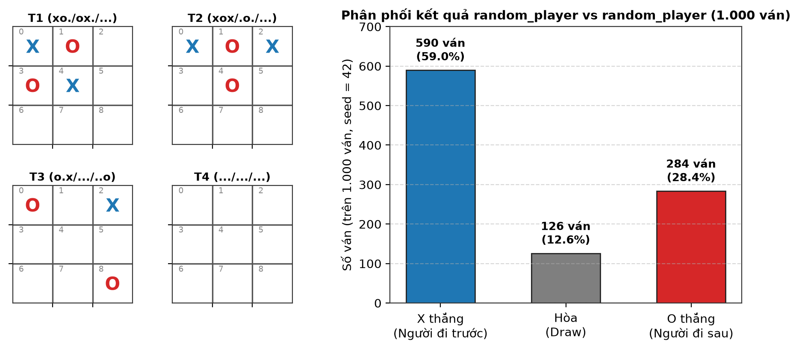
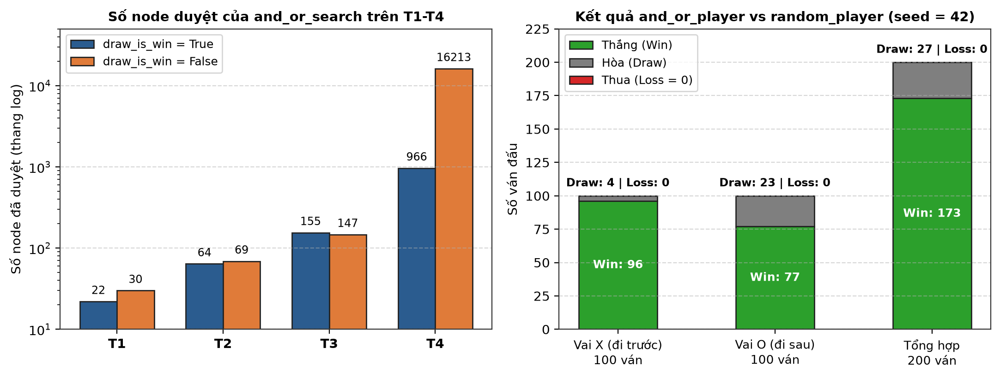
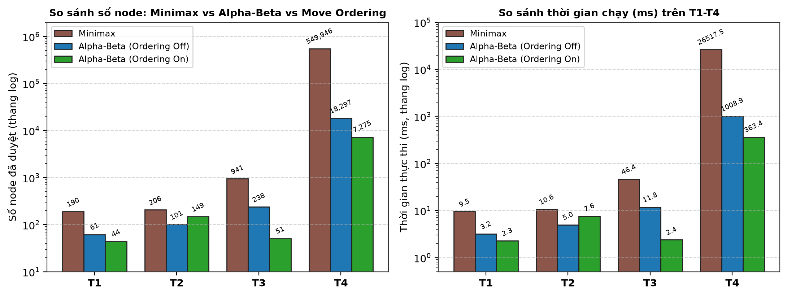
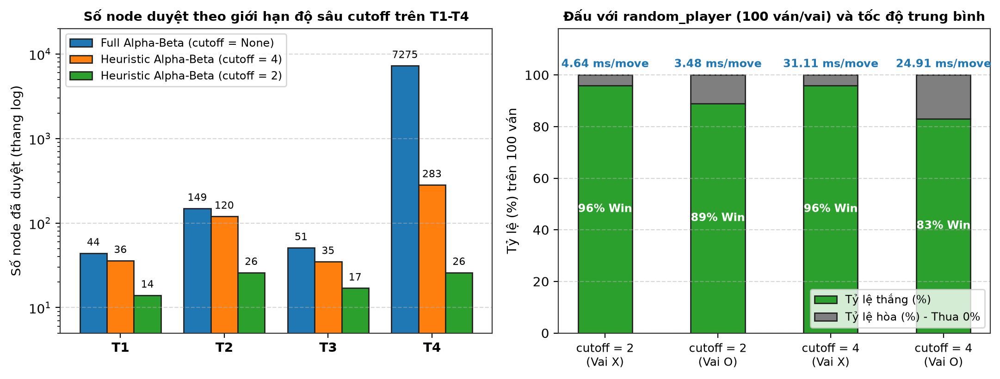
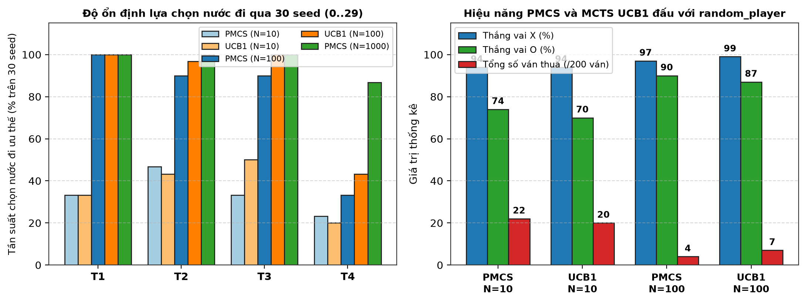
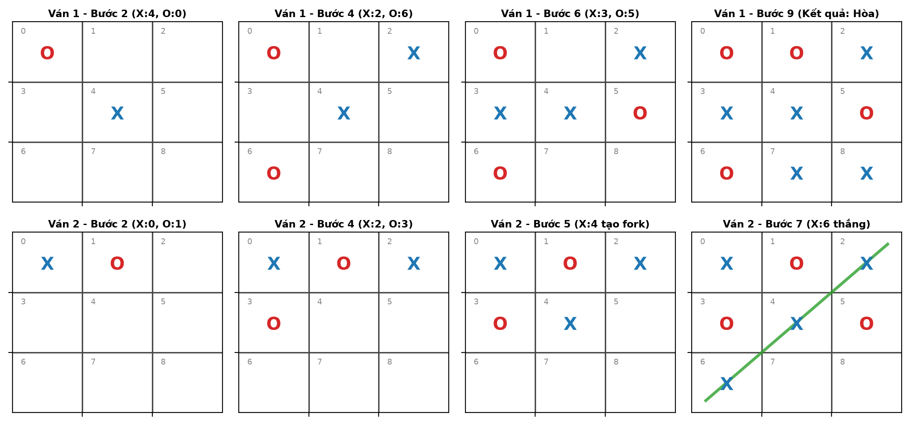
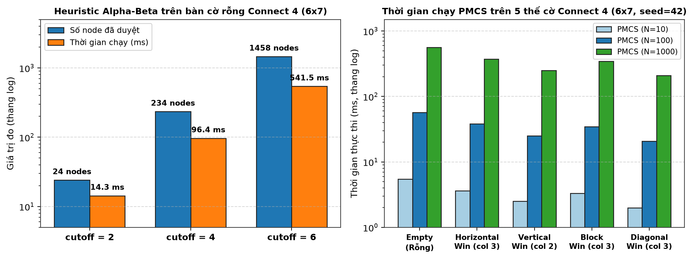
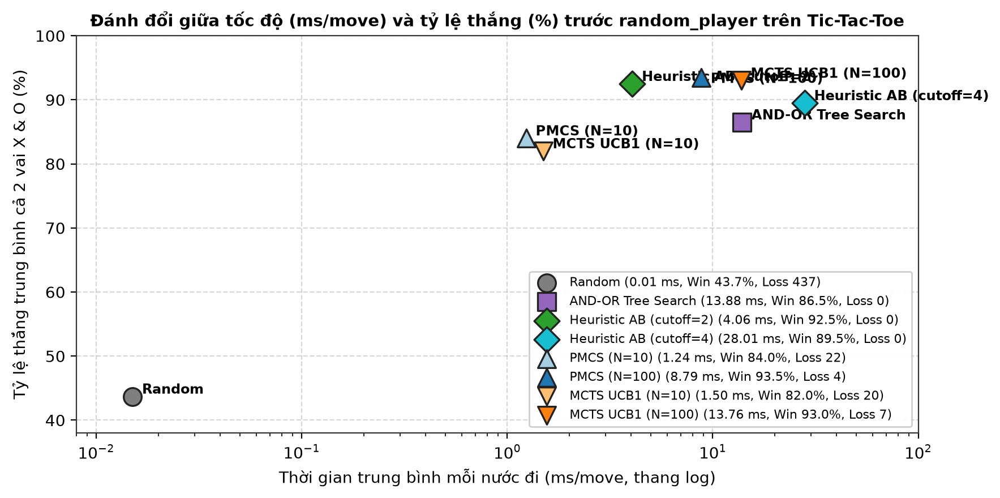

# BÁO CÁO LAB 05 - TÌM KIẾM ĐỐI KHÁNG VÀ TRÒ CHƠI

> **Trường:** Đại học Sài Gòn - Khoa Công nghệ Thông tin  
> **Môn học:** Trí tuệ nhân tạo nâng cao  
> **Giảng viên hướng dẫn:** TS. Đỗ Như Tài  
> **Sinh viên thực hiện:** Trần Hồ Minh Hải (3123410092) - Trương Văn Thiện (3123410356) - Lê Thị Trúc Ly (3123410210)  
> **Thời gian:** Tháng 11 năm 2026

---

## BẢNG PHÂN CÔNG NHIỆM VỤ THÀNH VIÊN

| Thành viên | Các chương thực hiện | Phạm vi đóng góp |
|---|---|---|
| Trần Hồ Minh Hải - 3123410092 | Chương 1, Chương 2, Chương 7, Chương 8 - mục 8.1, 8.2 | Định nghĩa Tic-Tac-Toe, AND-OR Tree Search, chơi tương tác và module nền tảng Connect 4 |
| Trương Văn Thiện - 3123410356 | Chương 3, Chương 4, Chương 8 - mục 8.3, 8.4 | Minimax, Alpha-Beta pruning, move ordering và heuristic Alpha-Beta trên Tic-Tac-Toe, Connect 4 |
| Lê Thị Trúc Ly - 3123410210 | Chương 5, Chương 6, Chương 8 - mục 8.5, Chương 9 | Pure Monte Carlo Search, MCTS với UCB1 trên Tic-Tac-Toe, Connect 4 và tổng hợp thảo luận |

---

# Chương 1. ĐỊNH NGHĨA TRÒ CHƠI TIC-TAC-TOE

## 1.1. Mục tiêu

Chương này xây dựng mô hình toán học và cài đặt các thành phần nền tảng cho trò chơi đối kháng hai người Tic-Tac-Toe trong module tictactoe.py và notebook tictactoe_definitions.ipynb. Toàn bộ các thuật toán tìm kiếm ở những chương tiếp theo đều sử dụng chung tập hàm giao diện được định nghĩa tại đây.

Sau chương này, mô hình trò chơi cần giải quyết trọn vẹn bốn nhiệm vụ cốt lõi:

1. Biểu diễn tường minh một state của bàn cờ 3x3 và xác định tập actions hợp lệ tại mỗi lượt đi.
2. Cài đặt transition model thông qua hàm result đảm bảo tính bất biến của state gốc, kết hợp với hàm kiểm tra terminal và hàm tính utility theo góc nhìn của từng player.
3. Phân tích lý thuyết độ lớn của state space và game tree để lượng hóa độ phức tạp không gian cũng như thời gian.
4. Xây dựng random_player và vòng lặp play để khảo sát phân phối thắng, hòa, thua qua 1.000 ván thực nghiệm.
## 1.2. Mô hình bài toán và biểu diễn state

Tic-Tac-Toe là một deterministic, turn-taking, two-player, zero-sum game với thông tin hoàn hảo. Hai người chơi được ký hiệu là x và o, trong đó x luôn là người đi trước. Một bài toán trò chơi đối kháng chuẩn được đặc trưng bởi sáu thành phần cơ bản trong bảng dưới đây:

| Thành phần | Ý nghĩa trong mô hình trò chơi | Biểu diễn trong code Python |
|---|---|---|
| Initial state | Bàn cờ 3x3 trống hoàn toàn khi bắt đầu ván đấu | empty_board() trả về [' '] * 9 |
| Player | Người chơi đang giữ quyền đi tại state hiện tại | Chuỗi ký tự 'x' hoặc 'o', chuyển lượt bằng other(player) |
| Actions | Tập các ô trống hợp lệ có thể đánh tại state s | actions(s) trả về list các chỉ số i từ 0 đến 8 có s[i] == ' ' |
| Transition model | State mới sinh ra sau khi player thực hiện action a trên state s | result(s, player, a) sao chép s và gán s_copy[a] = player |
| Terminal test | Kiểm tra ván cờ đã kết thúc do có người thắng hoặc hết ô trống | terminal(s) trả về True hoặc False |
| Utility function | Điểm số tại terminal state tính theo góc nhìn của player | utility(s, player) trả về +1 nếu thắng, 0 nếu hòa, -1 nếu thua |

Trong cài đặt thực tế, mỗi state của bàn cờ 3x3 được biểu diễn bằng một list gồm 9 phần tử tương ứng với 9 ô đánh số từ 0 đến 8 theo thứ tự từ trái sang phải và từ trên xuống dưới. Hàng đầu tiên gồm các chỉ số 0, 1, 2; hàng giữa gồm 3, 4, 5; hàng cuối gồm 6, 7, 8. Mỗi phần tử nhận một trong ba giá trị gồm ký tự khoảng trắng cho ô trống, ký tự x hoặc ký tự o.

Điểm kỹ thuật quan trọng nhất trong hàm result là phải tạo bản sao độc lập bằng phương thức copy trước khi cập nhật nước đi. Nhờ giữ tính bất biến cho state đầu vào, các thuật toán tìm kiếm đệ quy như AND-OR tree search, Minimax hay Alpha-Beta pruning có thể mở rộng nhiều nhánh con từ cùng một node cha mà không làm hỏng dữ liệu của các nhánh anh em.

```python
def actions(state):
    return [i for i, mark in enumerate(state) if mark == ' ']

def result(state, player, action):
    if state[action] != ' ':
        raise ValueError(f"Illegal action {action} on occupied cell.")
    next_state = state.copy()
    next_state[action] = player
    return next_state

def terminal(state):
    return utility(state, 'x') is not None

def utility(state, player):
    opponent = other(player)
    for a, b, c in WIN_LINES:
        if state[a] == state[b] == state[c] != ' ':
            return 1 if state[a] == player else -1
    if ' ' not in state:
        return 0
    return None
```

Tập WIN_LINES lưu 8 đường chiến thắng gồm 3 hàng ngang, 3 cột dọc và 2 đường chéo. Hàm utility trả về None khi state chưa kết thúc, giúp hàm terminal tái sử dụng trực tiếp kết quả kiểm tra mà không cần duyệt lại bàn cờ lần thứ hai.

## 1.3. Khảo sát lý thuyết state space và game tree

Việc phân biệt rõ state space và game tree là cơ sở để lựa chọn thuật toán tìm kiếm phù hợp. Một state chỉ phản ánh cấu hình hiện tại của 9 ô trên bàn cờ, trong khi một node trên game tree đại diện cho một lịch sử thứ tự các action dẫn từ root tới cấu hình đó. Nhiều đường đi khác nhau trên game tree có thể hội tụ về cùng một state thông qua các phép hoán vị thứ tự nước đi.

Nếu ước lượng thô bằng cách cho mỗi ô nhận độc lập một trong ba giá trị, cận trên sơ bộ của state space là 3^9 = 19.683 cấu hình. Tuy nhiên, quy tắc luân phiên lượt đi giữa x và o bắt buộc số quân x tại mọi thời điểm chỉ có thể bằng hoặc nhiều hơn số quân o đúng 1 đơn vị. Khi cố định tổng số quân đã đánh trên bàn cờ là i, số quân x là ceil(i/2) và số quân o là floor(i/2). Số cấu hình hợp lệ theo ràng buộc lượt đi đối với các bàn cờ từ 1 đến 8 quân là tổng của C(9, i) * C(i, floor(i/2)) với i chạy từ 1 đến 8, đạt 5.919 cấu hình; nếu tính thêm bàn cờ rỗng ban đầu và 126 cấu hình đầy 9 quân thì cận trên tổ hợp đạt 6.046 cấu hình. Khi loại bỏ tiếp các cấu hình bất khả thi do cả hai người chơi cùng tạo thành hàng 3 quân hoặc tiếp tục đánh sau khi đã đạt terminal state, số state hợp lệ thực sự có thể chạm tới là 5.478.

| Đại lượng lý thuyết | Công thức hoặc cơ sở ước lượng | Giá trị số học | Ý nghĩa đối với thuật toán search |
|---|---|---|---|
| Cận trên thô của state space | 3^9 cấu hình độc lập trên 9 ô | 19.683 | Không tính đến quy tắc luân phiên lượt đi |
| Cận trên tổ hợp theo lượt đi | Tổng C(9, i) * C(i, floor(i/2)) với i = 0..9 | 6.046 | Loại bỏ các cấu hình sai lệch số quân x và o |
| Số state hợp lệ thực tế | Loại cấu hình tiếp diễn sau terminal state | 5.478 | Kích thước thực của bảng nhớ transposition table |
| Cận trên số leaf của game tree | 9! hoán vị đánh hết 9 ô | 362.880 | Số ván đấu tối đa nếu không dừng sớm khi thắng |
| Số leaf thực tế của game tree | Dừng nhánh ngay khi chạm terminal state | 255.168 | Số ván đấu hợp lệ khác nhau có thể xảy ra |
| Cận trên tổng số node của game tree | Tổng 9! / i! với i chạy từ 0 đến 9 | 986.410 | Tổng số node tối đa nếu duyệt toàn bộ cây không cắt tỉa |
| Tổng số node thực tế của game tree | Cây dừng ngay tại các terminal state | 549.946 | Số node thực tế mà Minimax toàn phần phải duyệt từ T4 |
| Space complexity của DFS trên cây | O(b * m) với b = 9 và m = 9 | 81 | Chi phí bộ nhớ tuyến tính cực nhỏ theo độ sâu |
| Time complexity cận thô | O(b^m) với b = 9 và m = 9 | 387.420.489 | Minh họa sự cần thiết của cắt tỉa trên cây tìm kiếm |

Số liệu trong bảng giải thích vì sao ở Chương 3, thuật toán Minimax duyệt từ bàn cờ rỗng T4 mở rộng chính xác 549.946 node. Con số này nhỏ hơn cận trên tổ hợp 986.410 node bởi mọi nhánh đạt trạng thái thắng ở độ sâu từ 5 đến 8 đều dừng ngay lập tức mà không sinh thêm các node con dư thừa.

## 1.4. Thực nghiệm random_player đấu với random_player

Để thiết lập baseline thực nghiệm, notebook tictactoe_definitions.ipynb cài đặt tác tử random_player chọn ngẫu nhiên đồng đều một action từ tập actions(state) và hàm play điều phối toàn bộ ván đấu từ empty_board cho tới khi đạt terminal state. Thí nghiệm chạy 1.000 ván độc lập giữa hai random_player với seed = 42 để đảm bảo khả năng tái lập hoàn toàn.

| Chỉ số thống kê trên 1.000 ván | Người đi trước x | Người đi sau o | Hòa hoặc tổng hợp |
|---|---|---|---|
| Số ván thắng | 590 | 284 | 126 ván hòa |
| Tỷ lệ phần trăm kết quả | 59,0% | 28,4% | 12,6% hòa |
| Tổng số move đã thực hiện | 4.191 | 3.475 | 7.666 move tổng cộng |
| Tổng thời gian suy nghĩ | 0,0615 s | 0,0502 s | 0,1117 s tổng cộng |
| Thời gian trung bình mỗi move | 0,0147 ms | 0,0145 ms | 0,0146 ms trung bình |



> **Hình . Bốn state kiểm thử chuẩn T1-T4 trên bàn cờ 3x3 và phân phối kết quả 1.000 ván random_player đấu với random_player tại seed = 42.**

Kết quả thực nghiệm phản ánh rõ lợi thế cấu trúc của người đi trước trong Tic-Tac-Toe. Trong một ván cờ kéo dài tối đa 9 ply, người chơi x được đặt tới 5 quân trong khi người chơi o chỉ đặt tối đa 4 quân. Số tổ hợp 3 ô thẳng hàng tạo được từ 5 quân chọn trong 9 ô lớn hơn đáng kể so với từ 4 quân, giúp tỷ lệ thắng của x đạt 59,0%, gấp hơn hai lần tỷ lệ thắng 28,4% của o và sát với xác suất lý thuyết 58,5% của trò chơi ngẫu nhiên.

## 1.5. Kết luận chương

Chương 1 đã hoàn thiện bộ giao diện chuẩn của trò chơi Tic-Tac-Toe gồm empty_board, actions, result, terminal, utility, random_player và play. Phân tích lý thuyết xác định rõ quy mô 5.478 state hợp lệ và 549.946 node trên game tree thực tế, đồng thời thực nghiệm 1.000 ván ngẫu nhiên đã cung cấp đường cơ sở định lượng cho các thuật toán tìm kiếm ở những chương tiếp theo.

---

# Chương 2. GIẢI TIC-TAC-TOE BẰNG AND-OR TREE SEARCH

## 2.1. Mục tiêu

Chương này tiếp cận Tic-Tac-Toe dưới góc nhìn của bài toán tìm kiếm trong môi trường bất định thông qua thuật toán AND-OR tree search được cài đặt trong notebook tictactoe_and_or_tree_search.ipynb. Thay vì gán điểm số cho từng state, thuật toán tìm cách xây dựng một conditional plan bảo đảm dẫn agent tới mục tiêu bất chấp mọi nước đi phản kháng của đối thủ.

Bốn mục tiêu cụ thể của chương bao gồm:

1. Mô hình hóa lượt đi của đối thủ như các kết quả bất định của môi trường thông qua hàm results(state, action, player).
2. Cài đặt bộ ba hàm đệ quy and_or_search, or_search và and_search kèm theo cơ chế kiểm tra cycle trên đường đi và tùy chọn mục tiêu draw_is_win.
3. Khảo sát hành vi, số node duyệt và thời gian chạy trên bốn state chuẩn T1, T2, T3, T4 ở cả hai chế độ draw_is_win = True và draw_is_win = False.
4. Xây dựng and_or_player hoàn chỉnh và đánh giá hiệu năng đối kháng qua 200 ván đấu với random_player ở cả hai vai x và o.
## 2.2. Mô hình hóa đối thủ như môi trường bất định

Trong AND-OR tree search, agent xem chính mình là tác tử ra quyết định tại các OR node và xem đối thủ như một môi trường bất định tại các AND node. Khi agent thực hiện một action a tại state hiện tại, hàm results(state, action, player) tính toán trước state trung gian s_mid = result(state, player, a). Nếu s_mid đã là terminal state thì tập kết quả trả về chỉ gồm duy nhất s_mid; ngược lại, đối thủ có thể chọn bất kỳ ô trống nào còn lại, nên hàm trả về danh sách toàn bộ các state kế tiếp ứng với mọi phản đòn hợp lệ của đối thủ.

| Hàm thành phần | Loại node xử lý | Điều kiện thành công | Giá trị trả về khi thành công |
|---|---|---|---|
| or_search | OR node thuộc lượt của agent | Tồn tại ít nhất một action a thỏa mãn and_search trên tập results | Cặp [action, subplan] tương ứng với nhánh đầu tiên thỏa mãn |
| and_search | AND node thuộc lượt của đối thủ | Mọi state s_i trong tập results đều thỏa mãn or_search | Danh sách các nhánh điều kiện [['if', s_1, 'then', plan_1], ...] |
| is_goal | Terminal state | utility == 1 hoặc utility >= 0 khi bật draw_is_win = True | Danh sách rỗng [] đánh dấu điểm kết thúc của conditional plan |

Cấu trúc cốt lõi của thuật toán đệ quy được cài đặt trực tiếp như sau:

```python
def results(state, action, player):
    s_mid = result(state, player, action)
    if terminal(s_mid):
        return [s_mid]
    opp = other(player)
    return [result(s_mid, opp, a) for a in actions(s_mid)]

def or_search(state, player, path, draw_is_win, counter):
    counter['nodes'] += 1
    if terminal(state):
        u = utility(state, player)
        if u == 1 or (draw_is_win and u == 0):
            return []
        return None
    if state in path:
        return None
    for action in actions(state):
        plan = and_search(results(state, action, player), player, path + [state], draw_is_win, counter)
        if plan is not None:
            return [action, plan]
    return None
```

Trong Tic-Tac-Toe, mỗi nước đi làm giảm số ô trống đi 1 nên đồ thị trạng thái là một đồ thị có hướng không chu trình. Dù vậy, điều kiện kiểm tra state in path vẫn được giữ đúng theo chuẩn lý thuyết của AND-OR tree search nhằm đảm bảo tính tổng quát cho các trò chơi có trạng thái lặp.

## 2.3. Khảo sát trên bốn state chuẩn T1, T2, T3, T4

Bốn state chuẩn T1, T2, T3, T4 đại diện cho bốn tình huống chiến thuật khác nhau khi x tới lượt đi: T1 là thế cờ x đang chiếm ưu thế thắng; T2 là thế cờ x bị o đe dọa thắng trực tiếp ở cột giữa và chỉ có thể thủ hòa nếu đối thủ chơi tối ưu; T3 là thế cờ x đã rơi vào bẫy thua trước hai đường đe dọa của o; T4 là bàn cờ rỗng lúc khai cuộc. Bảng dưới đây trình bày kết quả thực nghiệm của and_or_search trên cả bốn state:

| State | Biểu diễn bàn cờ | Chế độ mục tiêu | Tìm thấy plan | Action đầu tiên | Số node duyệt | Thời gian (ms) |
|---|---|---|---|---|---|---|
| T1 | xo. / ox. / ... | draw_is_win = True | Có | 2 | 22 | 0,706 |
| T1 | xo. / ox. / ... | draw_is_win = False | Có | 2 | 30 | 0,866 |
| T2 | xox / .o. / ... | draw_is_win = True | Có | 7 | 64 | 1,741 |
| T2 | xox / .o. / ... | draw_is_win = False | Không | None | 69 | 1,577 |
| T3 | o.x / ... / ..o | draw_is_win = True | Không | None | 155 | 4,109 |
| T3 | o.x / ... / ..o | draw_is_win = False | Không | None | 147 | 4,064 |
| T4 | ... / ... / ... | draw_is_win = True | Có | 0 | 966 | 41,473 |
| T4 | ... / ... / ... | draw_is_win = False | Không | None | 16.213 | 545,762 |

Từ số liệu thực nghiệm trên bốn state chuẩn, bốn hiện tượng quan trọng được làm rõ:

- Lý do T1 chọn ô 2 thay vì ô 8: Trên T1, dù đánh vào ô 8 giúp x thắng ngay lập tức theo đường chéo chính 0-4-8, thuật toán lại trả về action 2 ở cả hai chế độ. Nguyên nhân là hàm actions(state) liệt kê các ô trống theo thứ tự chỉ số tăng dần 2, 5, 6, 7, 8 và vòng lặp trong or_search dừng ngay khi gặp action đầu tiên tạo được conditional plan hợp lệ. Khi x đánh vào ô 2, x tạo ra hai mối đe dọa thắng đồng thời tại ô 5 và ô 8 khiến o không thể chống đỡ, nên action 2 vẫn bảo đảm chiến thắng 100%.
- Sự khác biệt giữa hai chế độ trên T2: Trên T2, o đang có hai quân tại ô 1 và ô 4, đe dọa đánh vào ô 7 để thắng ngay. Khi bật draw_is_win = True, thuật toán chọn chính xác action 7 để chặn đường thắng của o và ép ván cờ về kết quả tối thiểu là hòa sau 64 node. Khi đặt draw_is_win = False, vì o luôn có cách thủ hòa sau khi bị chặn tại ô 7 nên không tồn tại chiến lược nào ép thắng tuyệt đối, dẫn đến kết quả trả về None sau 69 node.
- Trạng thái tất bại T3: Trên T3, o đã chiếm hai góc đối diện 0 và 8 trong khi x chỉ có một quân ở góc 2. Nếu đối thủ o chơi tối ưu, o chắc chắn tạo được bẫy hai đường thắng mà x không thể đỡ hết. Do đó, ngay cả khi nới lỏng mục tiêu với draw_is_win = True, and_or_search vẫn trả về None sau 155 node.
- Sự bùng nổ số node trên T4 khi tắt draw_is_win: Trên bàn cờ rỗng T4, Tic-Tac-Toe là trò chơi có giá trị lý thuyết bằng 0 khi hai bên chơi hoàn hảo. Với draw_is_win = True, nhánh đầu tiên tại ô 0 nhanh chóng chứng minh được khả năng bất bại chỉ sau 966 node và 41,473 ms. Ngược lại, với draw_is_win = False, thuật toán buộc phải bác bỏ toàn bộ 9 nước đi mở màn vì không nước nào ép thắng được một đối thủ tối ưu, làm số node duyệt tăng gấp 16,8 lần lên 16.213 node và tốn 545,762 ms.
## 2.4. Thực nghiệm and_or_player đấu với random_player

Để biến thuật toán tìm kiếm thành một agent thi đấu thực전, hàm and_or_player kết hợp linh hoạt hai mức mục tiêu: trước hết thử gọi and_or_search với draw_is_win = False để tìm nước thắng chắc chắn; nếu không có chiến lược ép thắng thì gọi tiếp với draw_is_win = True để bảo toàn thế bất bại; trong trường hợp rơi vào thế cờ bị dẫn trước như T3 mà cả hai lần gọi đều trả về None, agent kiểm tra nước chặn thắng trực tiếp của đối thủ trước khi chọn ô trống đầu tiên.

| Vai trò của and_or_player | Số ván | Thắng | Hòa | Thua | Tổng số move | Tổng thời gian (s) | Thời gian TB (ms/move) |
|---|---|---|---|---|---|---|---|
| Cầm quân X đi trước | 100 | 96 | 4 | 0 | 353 | 3,8463 | 10,896 |
| Cầm quân O đi sau | 100 | 77 | 23 | 0 | 361 | 6,0609 | 16,789 |
| Tổng hợp cả hai vai | 200 | 173 | 27 | 0 | 714 | 9,9072 | 13,876 |



> **Hình . So sánh số node duyệt của and_or_search trên T1-T4 và thành tích bất bại của and_or_player qua 200 ván đấu với random_player.**

Qua 200 ván thực nghiệm với seed = 42, and_or_player đạt tỷ lệ bất bại tuyệt đối 100% với 0 ván thua. Khi cầm quân x đi trước, agent thắng tới 96% số ván và chỉ hòa 4%; khi cầm quân o đi sau, do phải ưu tiên phòng thủ trước nước mở màn của đối thủ, tỷ lệ thắng đạt 77% và tỷ lệ hòa là 23%. Thời gian suy nghĩ trung bình chỉ khoảng 13,876 ms cho mỗi move nhờ cơ chế lưu và tái sử dụng subplan theo tiến trình ván đấu.

## 2.5. Kết luận chương

AND-OR tree search cung cấp một phương pháp chặt chẽ để tổng hợp chiến lược có điều kiện trong trò chơi đối kháng. Tuy nhiên, vì thuật toán chỉ phân loại kết quả theo tiêu chí nhị phân đạt hoặc không đạt mục tiêu nên không phân biệt được độ ưu việt giữa nước thắng nhanh ở ô 8 và nước thắng chậm ở ô 2 trên T1. Hạn chế này dẫn trực tiếp tới nhu cầu tối ưu hóa giá trị utility bằng Minimax và Alpha-Beta pruning ở Chương 3.

---

# Chương 3. MINIMAX VÀ ALPHA-BETA PRUNING

## 3.1. Mục tiêu

Chương này chuyển từ cách tiếp cận thỏa mãn mục tiêu nhị phân sang bài toán tối ưu hóa giá trị đối kháng thông qua thuật toán Minimax và kỹ thuật cắt tỉa Alpha-Beta pruning trong notebook tictactoe_alpha_beta_tree_search.ipynb.

Các mục tiêu trọng tâm của chương gồm:

1. Cài đặt thuật toán Minimax chuẩn xác định giá trị tối ưu tại mọi state và tập toàn bộ các action đạt giá trị tối ưu đó.
2. Cài đặt Alpha-Beta pruning duy trì hai cận alpha và beta để cắt bỏ các nhánh con không thể làm thay đổi quyết định tại root.
3. Thiết kế chiến lược move ordering ưu tiên tâm, góc, cạnh và đo lường định lượng tỷ lệ giảm số node cũng như thời gian thực thi trên bộ state chuẩn T1, T2, T3, T4.
## 3.2. Thuật toán Minimax và tính tối ưu đối kháng

Trong một zero-sum game hai người chơi, lợi ích của agent hoàn toàn đối lập với lợi ích của đối thủ. Thuật toán Minimax gán cho mỗi state s một giá trị đối kháng duy nhất thông qua hai hàm đệ quy tương hỗ: max_value tại lượt của agent cố gắng cực đại hóa utility và min_value tại lượt của đối thủ cố gắng cực tiểu hóa utility của agent. Tại các terminal state, cả hai hàm đều trả về trực tiếp utility(state, root_player).

Vì Minimax duyệt vét cạn toàn bộ cây con dưới mỗi action hợp lệ để tìm giá trị chính xác, thuật toán đảm bảo luôn chọn được nước đi tối ưu trước một đối thủ chơi hoàn hảo. Tuy nhiên, chi phí duyệt toàn bộ 549.946 node từ bàn cờ rỗng T4 khiến thời gian phản hồi ở nước đi đầu tiên lên tới hơn 26,5 giây, đòi hỏi phải áp dụng cơ chế cắt tỉa nhánh.

## 3.3. Cơ chế Alpha-Beta pruning và move ordering

Alpha-Beta pruning giữ nguyên kết quả toán học của Minimax nhưng truyền thêm hai tham số dọc theo đường đi đệ quy: alpha là giá trị tốt nhất mà MAX đã được bảo đảm trên đường từ root tới node hiện tại, còn beta là giá trị tốt nhất mà MIN đã được bảo đảm. Tại một MAX node, ngay khi giá trị tạm thời v lớn hơn hoặc bằng beta, các nhánh con còn lại của node đó bị cắt bỏ hoàn toàn vì MIN ở tầng cha sẽ không bao giờ cho phép trận đấu đi vào node này. Tương tự, tại một MIN node, nhánh hiện tại bị cắt ngay khi v nhỏ hơn hoặc bằng alpha.

| Thành phần kỹ thuật | Quy tắc hoạt động | Tác động lên cây tìm kiếm |
|---|---|---|
| Tham số alpha | Khởi tạo bằng -infinity, cập nhật alpha = max(alpha, v) tại MAX node | Thiết lập cận dưới tối thiểu mà MAX chắc chắn đạt được |
| Tham số beta | Khởi tạo bằng +infinity, cập nhật beta = min(beta, v) tại MIN node | Thiết lập cận trên tối đa mà MIN cho phép MAX nhận được |
| Beta cutoff tại MAX | Dừng vòng lặp duyệt actions ngay khi v >= beta | Loại bỏ các nhánh thừa khi MAX tìm thấy phương án vượt ngưỡng của MIN |
| Alpha cutoff tại MIN | Dừng vòng lặp duyệt actions ngay khi v <= alpha | Loại bỏ các nhánh thừa khi MIN tìm thấy đòn phản công mạnh hơn ngưỡng của MAX |
| Move ordering tĩnh | Sắp xếp actions theo thứ tự [4, 0, 2, 6, 8, 1, 3, 5, 7] | Đưa các ô giàu đường thắng lên đầu để sớm thu hẹp khoảng [alpha, beta] |

Trên bàn cờ Tic-Tac-Toe 3x3, ô tâm 4 tham gia vào 4 đường chiến thắng, bốn ô góc 0, 2, 6, 8 mỗi ô tham gia vào 3 đường chiến thắng, còn bốn ô cạnh 1, 3, 5, 7 mỗi ô chỉ tham gia vào 2 đường chiến thắng. Do đó, chiến lược move ordering tĩnh sắp xếp các ô trống theo thứ tự ưu tiên tâm rồi đến góc và cuối cùng là cạnh:

```python
PREFERRED_ORDER = (4, 0, 2, 6, 8, 1, 3, 5, 7)

def ordered_actions(state, use_ordering=True):
    legal = set(actions(state))
    if not use_ordering:
        return sorted(legal)
    return [a for a in PREFERRED_ORDER if a in legal]
```

## 3.4. Thực nghiệm so sánh trên T1, T2, T3, T4

Thí nghiệm đầu tiên trong notebook tictactoe_alpha_beta_tree_search.ipynb đặt Minimax và Alpha-Beta pruning khi chưa bật move ordering lên cùng bộ bốn state chuẩn T1, T2, T3, T4:

| State | Tập action tối ưu | Minimax: Action / Value | Minimax: Số node | Minimax: Thời gian (ms) | Alpha-Beta: Action / Value | Alpha-Beta: Số node | Alpha-Beta: Thời gian (ms) |
|---|---|---|---|---|---|---|---|
| T1 | 2, 6, 8 | 2 / +1 | 190 | 9,494 | 2 / +1 | 61 | 3,156 |
| T2 | 7 | 7 / 0 | 206 | 10,616 | 7 / 0 | 101 | 4,982 |
| T3 | 1, 3, 4, 5, 6, 7 | 1 / -1 | 941 | 46,387 | 1 / -1 | 238 | 11,843 |
| T4 | 0, 1, 2, 3, 4, 5, 6, 7, 8 | 0 / 0 | 549.946 | 26.517,475 | 0 / 0 | 18.297 | 1.008,932 |

Thí nghiệm thứ hai đánh giá trực tiếp hiệu quả của move ordering đối với Alpha-Beta pruning trên cùng bốn state:

| State | Ordering Off: Action / Value | Ordering Off: Số node | Ordering Off: Thời gian (ms) | Ordering On: Action / Value | Ordering On: Số node | Ordering On: Thời gian (ms) | Tỷ lệ thay đổi số node |
|---|---|---|---|---|---|---|---|
| T1 | 2 / +1 | 61 | 3,205 | 2 / +1 | 44 | 2,280 | -27,9% |
| T2 | 7 / 0 | 101 | 5,995 | 7 / 0 | 149 | 7,576 | +47,5% |
| T3 | 1 / -1 | 238 | 12,048 | 4 / -1 | 51 | 2,394 | -78,6% |
| T4 | 0 / 0 | 18.297 | 875,534 | 4 / 0 | 7.275 | 363,398 | -60,2% |



> **Hình . So sánh số node đã duyệt và thời gian thực thi giữa Minimax, Alpha-Beta không sắp xếp và Alpha-Beta có move ordering trên T1-T4.**

Các số liệu thực nghiệm làm nổi bật ba kết luận quan trọng về mặt thuật toán:

- Tính bảo toàn nghiệm tối ưu: Ở mọi state từ T1 đến T4, cả Minimax và hai cấu hình Alpha-Beta đều trả về chính xác cùng một Minimax value và chọn nước đi nằm trong tập action tối ưu. Khi bật move ordering trên T3 và T4, thuật toán đổi sang chọn ô tâm 4 thay vì ô 1 hoặc ô 0 bởi ô 4 được xét đầu tiên trong danh sách ưu tiên và có cùng giá trị đối kháng tối ưu.
- Hiệu quả cắt tỉa vượt trội trên cây lớn: Ngay cả khi chưa dùng move ordering, Alpha-Beta pruning đã giảm 67,9% số node trên T1, 51,0% trên T2, 74,7% trên T3 và đặc biệt giảm tới 96,7% số node trên bàn cờ rỗng T4 từ 549.946 xuống còn 18.297 node, rút ngắn thời gian chạy từ 26,5 giây xuống 1,0 giây. Khi kết hợp thêm move ordering, số node trên T4 tiếp tục giảm thêm 60,2% xuống chỉ còn 7.275 node với thời gian 363,398 ms, đạt mức tăng tốc tổng cộng hơn 73 lần so với Minimax thuần túy.
- Giải thích hiện tượng tăng node cục bộ tại T2: Trên T2, việc bật move ordering tĩnh lại làm số node tăng từ 101 lên 149 node. Nguyên nhân là tại T2, nước đi duy nhất cứu hòa cho x là chặn đòn tại ô cạnh 7. Thứ tự ưu tiên tĩnh xếp các ô góc 6, 8 và các ô cạnh 3, 5 lên trước ô 7, buộc thuật toán phải duyệt và chứng minh thất bại trên bốn nhánh kém hiệu quả trước khi chạm tới nhánh tối ưu tại ô 7 để cập nhật cận alpha = 0.
## 3.5. Kết luận chương

Alpha-Beta pruning kết hợp move ordering đã giải quyết triệt để bài toán tìm kiếm chính xác trên Tic-Tac-Toe với thời gian dưới 0,4 giây cho cả bàn cờ rỗng. Tuy nhiên, với các trò chơi có state space lớn hơn nhiều bậc độ lớn như Connect 4 ở Chương 8, việc duyệt tới tận terminal state là bất khả thi. Chương 4 sẽ giải quyết giới hạn này bằng cách kết hợp Alpha-Beta với depth cutoff và hàm đánh giá heuristic.

---

# Chương 4. ALPHA-BETA VỚI HÀM ĐÁNH GIÁ HEURISTIC VÀ DEPTH CUTOFF

## 4.1. Mục tiêu

Chương này mở rộng thuật toán Alpha-Beta pruning bằng cách bổ sung giới hạn độ sâu tìm kiếm depth cutoff và hàm đánh giá tĩnh heuristic evaluation function trong notebook tictactoe_heuristic_alpha_beta_tree_search.ipynb.

Ba mục tiêu chính của chương bao gồm:

1. Thiết kế hàm đánh giá tuyến tính dựa trên số đường chiến thắng tiềm năng và chuẩn hóa giá trị về miền [-1, +1] để đồng nhất với utility tại terminal state.
2. Khảo sát sự thay đổi số node, thời gian chạy và độ chính xác của quyết định khi đặt cutoff = 2 và cutoff = 4 so với Full Alpha-Beta trên T1, T2, T3, T4.
3. Thực nghiệm 400 ván đấu với random_player để đánh giá tốc độ phản hồi và tỷ lệ thắng của agent ở từng mức độ sâu.
## 4.2. Thiết kế hàm đánh giá heuristic và cơ chế depth cutoff

Khi giới hạn độ sâu tìm kiếm bằng tham số cutoff, quá trình đệ quy dừng lại ngay khi gặp terminal state hoặc khi độ sâu hiện tại chạm ngưỡng depth >= cutoff. Tại các node bị dừng do chạm ngưỡng cutoff nhưng chưa phải terminal state, thuật toán gọi hàm đánh giá heuristic eval_fn(state, player) để ước lượng khả năng chiến thắng của player từ cấu hình hiện tại.

Hàm đánh giá cho Tic-Tac-Toe được xây dựng dựa trên đặc trưng cấu trúc của 8 đường chiến thắng trên bàn cờ. Ký hiệu X_2(s) và X_1(s) lần lượt là số đường chiến thắng tiềm năng chứa đúng 2 quân và 1 quân của player mà không bị quân nào của đối thủ chặn; tương tự O_2(s) và O_1(s) là số đường tiềm năng chứa 2 quân và 1 quân của đối thủ. Điểm thô E(s) được định nghĩa theo công thức tuyến tính:

```python
E(s) = 3 * X_2(s) + X_1(s) - (3 * O_2(s) + O_1(s))
```

Trọng số 3 gán cho các đường đã có 2 quân phản ánh mức độ đe dọa sát nút chỉ còn cách chiến thắng đúng một lượt đi. Vì trên một bàn cờ 3x3 giá trị tuyệt đối của E(s) đối với các trạng thái chưa kết thúc luôn nhỏ hơn 19, hàm eval_fn chia E(s) cho hằng số chuẩn hóa 19,0 và giới hạn trong khoảng [-0,95, +0,95]. Cách chuẩn hóa này đảm bảo mọi trạng thái thắng thực sự tại terminal state với utility = +1,0 luôn được ưu tiên tuyệt đối hơn bất kỳ ước lượng heuristic nào, đồng thời giữ tính đối xứng dấu E_player(s) = -E_opponent(s).

## 4.3. Khảo sát độ sâu cutoff trên T1, T2, T3, T4

Bảng dưới đây đối chiếu kết quả của Full Alpha-Beta có bật move ordering với hai cấu hình giới hạn độ sâu cutoff = 2 và cutoff = 4 trên bốn state chuẩn T1, T2, T3, T4:

| State | Full AB: Action / Value | Full AB: Node / Thời gian (ms) | cutoff = 2: Action / Value | cutoff = 2: Node / Thời gian (ms) | cutoff = 4: Action / Value | cutoff = 4: Node / Thời gian (ms) |
|---|---|---|---|---|---|---|
| T1 | 2 / +1,00 | 44 / 1,090 | 8 / +1,00 | 14 / 1,037 | 2 / +1,00 | 36 / 1,843 |
| T2 | 7 / 0,00 | 149 / 3,293 | 7 / -0,13 | 26 / 2,007 | 7 / -0,05 | 120 / 7,140 |
| T3 | 4 / -1,00 | 51 / 2,617 | 4 / -0,23 | 17 / 2,390 | 4 / -1,00 | 35 / 2,935 |
| T4 | 4 / 0,00 | 7.275 / 429,053 | 4 / +0,11 | 26 / 5,629 | 4 / +0,05 | 283 / 58,420 |

Phân tích bảng kết quả cho thấy những đặc điểm rất đáng chú ý:

- Khả năng chọn nước thắng trực tiếp tại T1: Ở cả bốn state T1, T2, T3, T4, cả hai mức cutoff = 2 và cutoff = 4 đều chọn ra nước đi thuộc tập tối ưu của Full Alpha-Beta. Đáng chú ý, tại T1 với cutoff = 2, thuật toán chọn thẳng ô 8 để thắng ngay ở độ sâu 1 thay vì chọn ô 2 như Full Alpha-Beta. Lý do là ở độ sâu 2 ply, nhánh đánh vào ô 2 chưa kịp chạm tới terminal state ở độ sâu 3 nên chỉ nhận giá trị heuristic xấp xỉ nhỏ hơn +1,0, trong khi nhánh đánh vào ô 8 chạm ngay terminal state với utility = +1,0.
- Tỷ lệ nén không gian tìm kiếm trên T4: Trên bàn cờ rỗng T4, việc đặt cutoff = 2 cắt giảm số node duyệt từ 7.275 xuống chỉ còn 26 node, tương đương mức giảm 99,64%, và rút ngắn thời gian từ 429,053 ms xuống 5,629 ms. Khi tăng lên cutoff = 4, số node là 283, giảm 96,11% so với tìm kiếm toàn phần và chỉ mất 58,420 ms.
- Ảnh hưởng của tầm nhìn độ sâu đối với thế cờ phức tạp: Trên T3, tại cutoff = 2 thuật toán chưa nhìn thấy hết chuỗi ép thua ở độ sâu 4 nên trả về giá trị ước lượng -0,23; khi nâng lên cutoff = 4, tầm nhìn của thuật toán bao phủ trọn vẹn các nhánh kết thúc và nhận diện chính xác giá trị tất bại -1,00.
## 4.4. Thực nghiệm đấu với random_player

Để kiểm chứng chất lượng thi đấu thực tế, hai cấu hình heuristic_alpha_beta với cutoff = 2 và cutoff = 4 được đưa vào thi đấu 100 ván ở vai x và 100 ván ở vai o trước random_player:

| Cấu hình thuật toán | Vai trò | Số ván | Thắng | Hòa | Thua | Tổng số move | Tổng thời gian (s) | Thời gian TB (ms/move) |
|---|---|---|---|---|---|---|---|---|
| Heuristic Alpha-Beta cutoff = 2 | X đi trước | 100 | 96 | 4 | 0 | 328 | 1,5233 | 4,644 |
| Heuristic Alpha-Beta cutoff = 2 | O đi sau | 100 | 89 | 11 | 0 | 322 | 1,1211 | 3,482 |
| Heuristic Alpha-Beta cutoff = 4 | X đi trước | 100 | 96 | 4 | 0 | 378 | 11,7614 | 31,115 |
| Heuristic Alpha-Beta cutoff = 4 | O đi sau | 100 | 83 | 17 | 0 | 351 | 8,7444 | 24,913 |



> **Hình . So sánh số node duyệt theo giới hạn cutoff trên T1-T4 và hiệu năng thi đấu của Heuristic Alpha-Beta trước random_player.**

Cả hai mức cutoff = 2 và cutoff = 4 đều duy trì thành tích bất bại 0 ván thua qua 200 ván đấu cho mỗi cấu hình. Một kết quả thực nghiệm thú vị là ở vai o, cấu hình cutoff = 2 đạt tỷ lệ thắng 89%, cao hơn mức 83% của cutoff = 4, đồng thời kết thúc ván đấu với ít nước đi hơn và nhanh hơn gấp 7 lần. Nguyên nhân là ở mức cutoff = 4, thuật toán nhìn thấy các nhánh phòng thủ dẫn tới kết quả hòa chắc chắn utility = 0,00 và đôi khi chọn nước đi an toàn sớm, trong khi ở mức cutoff = 2 hàm heuristic chấm điểm cao hơn cho các ô tạo nhiều đường thắng mở nên agent chủ động gài bẫy đối thủ ngẫu nhiên hiệu quả hơn.

## 4.5. Kết luận chương

Sự kết hợp giữa Alpha-Beta pruning, depth cutoff và hàm đánh giá heuristic giúp giảm hơn 99% chi phí tính toán ở đầu ván cờ mà vẫn bảo toàn khả năng bất bại trên Tic-Tac-Toe. Tuy nhiên, việc thiết kế hàm đánh giá phụ thuộc chặt chẽ vào tri thức đặc thù của từng trò chơi. Chương 5 và Chương 6 sẽ khảo sát nhóm phương pháp Monte Carlo không cần bất kỳ hàm heuristic thủ công nào.

---

# Chương 5. PURE MONTE CARLO SEARCH

## 5.1. Mục tiêu

Chương này trình bày thuật toán Pure Monte Carlo Search được cài đặt trong notebook tictactoe_pure_monte_carlo_search.ipynb. Khác với các thuật toán duyệt cây đối kháng ở các chương trước, phương pháp này đánh giá chất lượng của mỗi action thông qua trung bình thống kê của các lượt mô phỏng ngẫu nhiên playout từ trạng thái kế tiếp tới tận terminal state.

Ba mục tiêu cụ thể của chương gồm:

1. Cài đặt hàm mô phỏng ngẫu nhiên playout và thuật toán Pure Monte Carlo Search phân bổ ngân sách N lượt mô phỏng cho các action hợp lệ tại root.
2. Khảo sát độ ổn định của nước đi được chọn và thời gian chạy qua 30 seed độc lập từ 0 đến 29 trên bốn state chuẩn T1, T2, T3, T4 ứng với N = 10, 100, 1000.
3. Đánh giá hiệu năng thi đấu thực tế trước random_player qua 100 ván ở vai x và 100 ván ở vai o tại hai mức ngân sách N = 10 và N = 100.
## 5.2. Nguyên lý Pure Monte Carlo Search và cơ chế random playout

Pure Monte Carlo Search hoạt động hoàn toàn không cần hàm đánh giá heuristic đặc thù của trò chơi. Tại state hiện tại s với tập k = len(actions(s)) nước đi hợp lệ, thuật toán thực hiện ba bước tuần tự:

| Bước | Thao tác xử lý | Ý nghĩa thống kê |
|---|---|---|
| 1 | Liệt kê toàn bộ tập actions(s) tại root và chia ngân sách N lượt playout cho các action | Đảm bảo mọi nước đi hợp lệ đều được lấy mẫu thử nghiệm |
| 2 | Với mỗi lượt thử của action a, chuyển sang s_next = result(s, player, a) rồi cho hai bên đi ngẫu nhiên tới terminal state | Thu thập mẫu biến ngẫu nhiên utility(s_terminal, player) thuộc {-1, 0, +1} |
| 3 | Tính điểm trung bình tổng utility chia cho số lượt thử của từng action và chọn action đạt trung bình cao nhất | Xấp xỉ kỳ vọng toán học của giá trị nước đi trước đối thủ ngẫu nhiên |

Cài đặt cốt lõi của hàm mô phỏng playout và hàm lựa chọn nước đi được viết gọn như sau:

```python
def playout(state, next_player, root_player, rng):
    curr = state
    turn = next_player
    while not terminal(curr):
        move = rng.choice(actions(curr))
        curr = result(curr, turn, move)
        turn = other(turn)
    return utility(curr, root_player)

def pure_monte_carlo_search(state, player, N=100, rng=None):
    legal = actions(state)
    counts = {a: 0 for a in legal}
    totals = {a: 0.0 for a in legal}
    for i in range(N):
        a = legal[i % len(legal)]
        s_next = result(state, player, a)
        u = playout(s_next, other(player), player, rng)
        counts[a] += 1
        totals[a] += u
    return max(legal, key=lambda a: totals[a] / counts[a])
```

Ưu điểm lớn nhất của Pure Monte Carlo Search là chỉ cần biết luật chơi cơ bản thông qua actions, result, terminal và utility. Tuy nhiên, việc chia đều ngân sách N cho tất cả các action tại root khiến thuật toán vẫn phải tốn một lượng lớn lượt mô phỏng vào những nước đi rất yếu ngay cả khi các mẫu đầu tiên đã cho thấy chúng dẫn tới thất bại.

## 5.3. Khảo sát độ ổn định theo N trên T1, T2, T3, T4

Do sử dụng bộ sinh số ngẫu nhiên trong quá trình playout, quyết định của Pure Monte Carlo Search là một đại lượng ngẫu nhiên. Để đánh giá độ ổn định một cách khách quan, thí nghiệm chạy lặp lại 30 lần với seed chạy từ 0 đến 29 cho mỗi tổ hợp state và ngân sách N thuộc tập 10, 100, 1000:

| State | Ngân sách N | Action chọn nhiều nhất | Tần suất chọn (%) | Phân bố chi tiết trên 30 seed | Thời gian TB (ms) |
|---|---|---|---|---|---|
| T1 | 10 | 8 | 10/30 = 33,3% | 8:10, 2:9, 6:8, 5:3 | 0,768 |
| T1 | 100 | 8 | 30/30 = 100,0% | 8:30 | 5,387 |
| T1 | 1000 | 8 | 30/30 = 100,0% | 8:30 | 54,241 |
| T2 | 10 | 7 | 14/30 = 46,7% | 7:14, 6:6, 8:5, 3:3, 5:2 | 0,797 |
| T2 | 100 | 7 | 27/30 = 90,0% | 7:27, 6:2, 8:1 | 7,643 |
| T2 | 1000 | 7 | 30/30 = 100,0% | 7:30 | 64,583 |
| T3 | 10 | 4 | 10/30 = 33,3% | 4:10, 6:6, 5:4, 7:4, 1:3, 3:3 | 1,071 |
| T3 | 100 | 4 | 27/30 = 90,0% | 4:27, 6:2, 7:1 | 6,690 |
| T3 | 1000 | 4 | 30/30 = 100,0% | 4:30 | 65,800 |
| T4 | 10 | 0 | 7/30 = 23,3% | 0:7, 6:6, 4:5, 8:5, 2:4, 1:2, 5:1 | 3,165 |
| T4 | 100 | 4 | 10/30 = 33,3% | 4:10, 6:5, 8:5, 0:4, 2:4, 1:1, 5:1 | 20,657 |
| T4 | 1000 | 4 | 26/30 = 86,7% | 4:26, 2:2, 0:1, 6:1 | 154,297 |

Số liệu thực nghiệm qua 30 seed thể hiện rõ quy luật hội tụ theo luật số lớn:

- Nhiễu ngẫu nhiên lớn tại N = 10: Ở mức N = 10, mỗi ô trống chỉ nhận được từ 1 đến 2 lượt playout nên phương sai mẫu rất lớn. Tại T2, thuật toán chỉ phát hiện được nước chặn thua bắt buộc ở ô 7 trong 46,7% số lần chạy; tại T1, dù ô 8 là nước thắng ngay lập tức với điểm trung bình luôn bằng +1,0, vẫn có những seed mà ô 2 hoặc ô 6 ngẫu nhiên thắng cả 2 lượt playout và chia sẻ vị trí dẫn đầu.
- Sự hội tụ ổn định tại N = 100 và N = 1000: Khi tăng ngân sách lên N = 100, tần suất chọn ô 8 tại T1 đạt tuyệt đối 100%, đồng thời tần suất chọn nước phòng thủ tối ưu tại T2 và T3 đều tăng vọt lên 90,0%. Đến mức N = 1000, cả ba thế cờ T1, T2, T3 đều hội tụ 100% về một quyết định duy nhất trên toàn bộ 30 seed, còn trên bàn cờ rỗng T4 thuật toán chọn ô trung tâm 4 tới 86,7% số lần chạy vì ô trung tâm mang lại xác suất thắng ngẫu nhiên cao nhất.
## 5.4. Thực nghiệm đấu với random_player

Bảng dưới đây ghi nhận thành tích thi đấu của Pure Monte Carlo Search ở hai mức N = 10 và N = 100 khi đối đầu trực tiếp với random_player tại seed = 42:

| Cấu hình thuật toán | Vai trò | Số ván | Thắng | Hòa | Thua | Tổng số move | Tổng thời gian (s) | Thời gian TB (ms/move) |
|---|---|---|---|---|---|---|---|---|
| PMCS với N = 10 | X đi trước | 100 | 94 | 2 | 4 | 328 | 0,3685 | 1,123 |
| PMCS với N = 10 | O đi sau | 100 | 74 | 8 | 18 | 345 | 0,4650 | 1,348 |
| PMCS với N = 100 | X đi trước | 100 | 97 | 3 | 0 | 313 | 2,9693 | 9,487 |
| PMCS với N = 100 | O đi sau | 100 | 90 | 6 | 4 | 327 | 2,6471 | 8,095 |

Khi nâng N từ 10 lên 100, tổng số ván thua qua 200 ván giảm mạnh từ 22 ván xuống chỉ còn 4 ván, trong đó vai x đạt thành tích bất bại 97 thắng, 3 hòa, 0 thua và vai o tăng tỷ lệ thắng từ 74% lên 90%. Đổi lại, thời gian suy nghĩ trung bình mỗi move tăng tuyến tính gấp khoảng 7 đến 8 lần, từ 1,2 ms lên khoảng 8,8 ms.

## 5.5. Kết luận chương

Pure Monte Carlo Search chứng minh rằng chỉ cần lấy mẫu ngẫu nhiên đủ lớn, một agent không hề có tri thức heuristic vẫn có thể đạt tỷ lệ thắng trên 93% trước đối thủ ngẫu nhiên. Tuy nhiên, việc phân bổ playout đồng đều ở độ sâu 1 gây lãng phí tính toán trên các nhánh kém và giả định đối thủ ở các bước sâu hơn đi hoàn toàn ngẫu nhiên. Chương 6 khắc phục nhược điểm này bằng cấu trúc cây Monte Carlo Tree Search kết hợp công thức UCB1.

---

# Chương 6. MONTE CARLO TREE SEARCH VỚI UCB1

## 6.1. Mục tiêu

Chương này trình bày thuật toán Monte Carlo Tree Search sử dụng chính sách chọn nhánh Upper Confidence Bound 1 viết tắt là UCB1 trong notebook tictactoe_monte_carlo_tree_search_restricted.ipynb. Thay vì phân bổ đều lượt mô phỏng cho mọi nhánh tại root, thuật toán xây dựng dần một cây tìm kiếm bất đối xứng và tập trung ngân sách tính toán vào những nhánh có tiềm năng cao.

Các mục tiêu cụ thể của chương bao gồm:

1. Cài đặt cấu trúc node lưu trữ thống kê số lần thăm n_i, tổng điểm thưởng w_i và bốn pha lặp Selection, Expansion, Simulation, Backpropagation.
2. Áp dụng công thức UCB1 để cân bằng giữa exploitation và exploration ở mọi tầng của cây tìm kiếm.
3. Đặt kết quả độ ổn định trên T1, T2, T3, T4 và kết quả đối kháng với random_player của MCTS UCB1 cạnh Pure Monte Carlo Search để phân tích lợi thế cũng như chi phí quản lý cây.
## 6.2. Cấu trúc bốn pha của MCTS và công thức UCB1

Mỗi vòng lặp trong ngân sách N lượt mô phỏng của Monte Carlo Tree Search đi qua bốn pha chuẩn hóa:

| Pha xử lý | Hoạt động trên cây tìm kiếm | Vai trò trong thuật toán |
|---|---|---|
| 1. Selection | Đi từ root xuống theo các node đã mở rộng đầy đủ bằng cách chọn node con có điểm UCB1 lớn nhất | Hướng luồng mô phỏng vào vùng không gian trạng thái hứa hẹn hoặc ít được khám phá |
| 2. Expansion | Nếu node hiện tại chưa phải terminal state và còn action chưa thử, tạo thêm một node con mới | Mở rộng dần biên giới của cây tìm kiếm thêm một node mỗi vòng lặp |
| 3. Simulation | Từ node mới mở rộng, thực hiện một lượt random playout cho tới khi chạm terminal state | Thu thập giá trị utility thực nghiệm tại lá của ván đấu mô phỏng |
| 4. Backpropagation | Lan truyền ngược kết quả utility từ node vừa mở rộng lên tới root, cập nhật n_i và w_i | Cập nhật ước lượng giá trị theo đúng góc nhìn của người chơi tại từng tầng |

Tại pha Selection, khi một node cha đã có số lần thăm N_p và các node con đã được thăm ít nhất một lần với số lần thăm n_i cùng tổng điểm tích lũy w_i, chỉ số UCB1 của mỗi node con thứ i được xác định bởi:

```python
UCB1(i) = (w_i / n_i) + c * sqrt(ln(N_p) / n_i)
```

Trong công thức trên, thành phần thứ nhất w_i / n_i đại diện cho exploitation nhằm ưu tiên các nhánh đang có tỷ lệ thắng cao; thành phần thứ hai c * sqrt(ln(N_p) / n_i) với hằng số khám phá chuẩn c = sqrt(2) đại diện cho exploration nhằm cộng điểm thưởng cho những nhánh ít được thăm. Điểm kỹ thuật then chốt trong pha Backpropagation của trò chơi hai người là tổng điểm w_i tại mỗi node con phải được cộng theo góc nhìn của người chơi tại node cha vừa chọn action dẫn tới node con đó. Nhờ vậy, tại các tầng của đối thủ, UCB1 tự động ưu tiên những nước đi có lợi nhất cho đối thủ, mô phỏng đúng hành vi đối kháng Minimax khi N tiến ra vô cùng.

## 6.3. So sánh độ ổn định giữa PMCS và MCTS UCB1

Bảng dưới đây đặt kết quả khảo sát qua 30 seed từ 0 đến 29 của MCTS UCB1 cạnh Pure Monte Carlo Search tại hai mức ngân sách N = 10 và N = 100:

| State | Thuật toán và ngân sách | Action chọn nhiều nhất | Tần suất chọn (%) | Phân bố chi tiết trên 30 seed | Thời gian TB (ms) |
|---|---|---|---|---|---|
| T1 | PMCS N = 10 | 8 | 33,3% | 8:10, 2:9, 6:8, 5:3 | 0,768 |
| T1 | MCTS UCB1 N = 10 | 6 | 33,3% | 6:10, 8:9, 2:8, 5:3 | 1,015 |
| T1 | PMCS N = 100 | 8 | 100,0% | 8:30 | 5,387 |
| T1 | MCTS UCB1 N = 100 | 8 | 100,0% | 8:30 | 7,413 |
| T2 | PMCS N = 10 | 7 | 46,7% | 7:14, 6:6, 8:5, 3:3, 5:2 | 0,797 |
| T2 | MCTS UCB1 N = 10 | 7 | 43,3% | 7:13, 8:7, 6:5, 3:3, 5:2 | 0,959 |
| T2 | PMCS N = 100 | 7 | 90,0% | 7:27, 6:2, 8:1 | 7,643 |
| T2 | MCTS UCB1 N = 100 | 7 | 96,7% | 7:29, 8:1 | 9,990 |
| T3 | PMCS N = 10 | 4 | 33,3% | 4:10, 6:6, 5:4, 7:4, 1:3, 3:3 | 1,071 |
| T3 | MCTS UCB1 N = 10 | 4 | 50,0% | 4:15, 7:5, 3:4, 6:3, 5:2, 1:1 | 1,268 |
| T3 | PMCS N = 100 | 4 | 90,0% | 4:27, 6:2, 7:1 | 6,690 |
| T3 | MCTS UCB1 N = 100 | 4 | 100,0% | 4:30 | 12,975 |
| T4 | PMCS N = 10 | 0 | 23,3% | 0:7, 6:6, 4:5, 8:5, 2:4, 1:2, 5:1 | 3,165 |
| T4 | MCTS UCB1 N = 10 | 4 | 20,0% | 4:6, 6:6, 0:4, 2:4, 8:4, 1:3, 7:2, 3:1 | 3,576 |
| T4 | PMCS N = 100 | 4 | 33,3% | 4:10, 6:5, 8:5, 0:4, 2:4, 1:1, 5:1 | 20,657 |
| T4 | MCTS UCB1 N = 100 | 4 | 43,3% | 4:13, 8:5, 0:4, 6:4, 2:3, 5:1 | 24,456 |

Sự đối chiếu trực tiếp làm sáng tỏ ưu thế dẫn hướng của UCB1. Tại N = 100, MCTS UCB1 đạt độ ổn định cao hơn hẳn PMCS trên mọi thế cờ đòi hỏi tính toán nhiều bước: tại T2 tần suất chọn đúng nước chặn ô 7 tăng từ 90,0% lên 96,7%; tại T3 tần suất chọn ô trung tâm 4 tăng từ 90,0% lên tuyệt đối 100,0%; tại T4 tần suất nhận diện ô trung tâm 4 cũng tăng từ 33,3% lên 43,3%. Lý do là ngay khi các node con tương ứng với nước đi sai lầm bị đối thủ trừng phạt ở tầng thứ hai của cây, điểm trung bình của chúng sụt giảm mạnh và UCB1 lập tức ngừng cấp thêm playout cho các nhánh đó, dồn toàn bộ ngân sách còn lại để phân tích sâu các nhánh tốt.

## 6.4. Thực nghiệm đối kháng và phân tích chi phí tính toán

Kết quả thi đấu 200 ván của MCTS UCB1 trước random_player tại seed = 42 được tổng hợp trong bảng sau:

| Cấu hình thuật toán | Vai trò | Số ván | Thắng | Hòa | Thua | Tổng số move | Tổng thời gian (s) | Thời gian TB (ms/move) |
|---|---|---|---|---|---|---|---|---|
| MCTS UCB1 với N = 10 | X đi trước | 100 | 94 | 4 | 2 | 336 | 0,4615 | 1,373 |
| MCTS UCB1 với N = 10 | O đi sau | 100 | 70 | 12 | 18 | 349 | 0,5641 | 1,616 |
| MCTS UCB1 với N = 100 | X đi trước | 100 | 99 | 1 | 0 | 306 | 4,6058 | 15,052 |
| MCTS UCB1 với N = 100 | O đi sau | 100 | 87 | 6 | 7 | 324 | 4,0386 | 12,465 |



> **Hình . So sánh độ ổn định lựa chọn nước đi qua 30 seed và hiệu năng thi đấu trước random_player giữa PMCS và MCTS UCB1.**

Ở vai x với N = 100, MCTS UCB1 đạt tỷ lệ thắng 99%, cao nhất trong tất cả các thuật toán được khảo sát trên Tic-Tac-Toe, chỉ hòa 1 ván và không thua ván nào. Ở chiều ngược lại, thời gian trung bình mỗi move của MCTS UCB1 tại N = 100 là 12,465-15,052 ms, cao hơn khoảng 1,5 lần so với mức 8,095-9,487 ms của PMCS. Khoảng chênh lệch thời gian này đến từ chi phí cấp phát đối tượng node, tính toán hàm logarit và căn bậc hai trong công thức UCB1 ở pha Selection và cập nhật chuỗi node cha ở pha Backpropagation.

## 6.5. Kết luận chương

Monte Carlo Tree Search với UCB1 khắc phục thành công điểm yếu chia đều ngân sách của Pure Monte Carlo Search và nâng cao rõ rệt độ ổn định tại các thế cờ chiến thuật T2, T3, T4. Dù chi phí quản lý cây làm thời gian mỗi lượt tăng nhẹ trên bàn cờ nhỏ 3x3, kiến trúc bốn pha của MCTS là nền tảng tiêu chuẩn cho các trò chơi có branching factor và độ sâu lớn.

---

# Chương 7. CHƠI TIC-TAC-TOE TƯƠNG TÁC

## 7.1. Mục tiêu

Chương này tích hợp các thuật toán đã xây dựng vào một giao diện tương tác hoàn chỉnh trong notebook tictactoe_interactive.ipynb, cho phép người chơi đấu trực tiếp với AI agent ở cả hai vai x đi trước và o đi sau, đồng thời ghi nhận biên bản chi tiết để phân tích hành vi chiến thuật.

## 7.2. Thiết kế vòng lặp tương tác và kiểm tra hợp lệ

Hàm human_player được thiết kế tuân thủ đúng chữ ký hàm player(state, mark) của vòng lặp play. Trước mỗi nước đi, hệ thống hiển thị bàn cờ hiện tại kèm theo sơ đồ chỉ số 0..8 của những ô còn trống. Để ngăn chặn mọi thao tác nhập sai làm gián đoạn ván đấu, vòng lặp kiểm tra ba lớp điều kiện:

1. Kiểm tra chuỗi nhập vào có thể chuyển đổi thành số nguyên int hợp lệ hay không.
2. Kiểm tra chỉ số ô nằm trong miền từ 0 đến 8.
3. Kiểm tra ô được chọn phải nằm trong danh sách actions(state) hiện tại; nếu ô đã có quân cờ thì yêu cầu nhập lại ngay.
Bên cạnh chế độ nhập trực tiếp từ bàn phím thông qua hàm input, notebook hỗ trợ danh sách SCRIPTED_MOVES để tự động hóa việc chạy kiểm thử không tương tác khi thực thi toàn bộ notebook bằng công cụ nbconvert.

```python
def human_player(state, player):
    legal = actions(state)
    while SCRIPTED_MOVES:
        candidate = SCRIPTED_MOVES.pop(0)
        if candidate in legal:
            return candidate
    while True:
        raw = input(f"Player '{player}', enter move {legal}: ")
        try:
            move = int(raw.strip())
            if move in legal:
                return move
            print(f"Cell {move} is not available. Legal moves: {legal}")
        except ValueError:
            print("Invalid input. Please enter an integer index 0..8.")
```

## 7.3. Phân tích hai ván đấu thực tế với AI agent

Hai ván đấu thực nghiệm được thực hiện giữa người chơi và and_or_player để kiểm chứng khả năng công thủ toàn diện của AI agent ở cả hai vai trò:

| Ván đấu | Cấu hình hai bên | Chuỗi nước đi theo thứ tự ply | Số ply | Kết quả chung cuộc | Điểm nhấn chiến thuật |
|---|---|---|---|---|---|
| Ván 1 | Người chơi cầm X<br>and_or_player cầm O | X:4 -> O:0 -> X:2 -> O:6 -> X:3 -> O:5 -> X:7 -> O:1 -> X:8 | 9 | Hòa<br>utility = 0 | AI chiếm góc 0 sau khi X lấy tâm 4 và chặn chính xác ba mối đe dọa liên tiếp tại 6, 5, 1 |
| Ván 2 | and_or_player cầm X<br>Người chơi cầm O | X:0 -> O:1 -> X:2 -> O:3 -> X:4 -> O:5 -> X:6 | 7 | AI thắng<br>utility = +1 | O mở màn sai lầm ở ô cạnh 1; AI chiếm góc 0, 2 và tâm 4 tạo fork đôi ở ô 6 và ô 8 |



> **Hình . Diễn biến bàn cờ qua các bước quan trọng của Ván 1 thủ hòa 9 ply và Ván 2 chiến thắng bằng đòn fork ở ply thứ 7.**

Ở Ván 1, người chơi cầm quân x đi trước và chiếm ngay ô trung tâm 4. AI agent cầm quân o lập tức đáp trả chuẩn xác bằng ô góc 0 theo đúng lý thuyết mở màn tối ưu. Khi người chơi đánh tiếp vào góc 2 tạo đường chéo đe dọa 2-4-6, AI chặn ngay tại ô 6; khi người chơi đánh vào ô 3 đe dọa đường ngang 3-4-5, AI chặn tại ô 5; và khi người chơi đánh vào ô 7, AI khóa nốt ô 1 để đưa ván cờ về thế hòa chặt chẽ sau 9 nước đi.

Ở Ván 2, AI agent cầm quân x đi trước và mở màn tại góc 0. Khi người chơi cầm quân o mắc sai lầm chiến thuật là trả lời vào ô cạnh 1 thay vì bắt buộc phải chiếm ô trung tâm 4, and_or_player lập tức khai thác bằng chuỗi nước đi ép thắng: đánh vào góc 2 buộc o phải đỡ ở ô 3 hoặc bị thua ngay, sau đó chiếm ô trung tâm 4 ở ply thứ 5. Nước đi tại ô 4 tạo thành một đòn fork hoàn hảo đe dọa thắng đồng thời trên đường chéo phụ 2-4-6 và đường chéo chính 0-4-8. Khi người chơi đánh vào ô 5 ở ply thứ 6, AI kết thúc ván đấu bằng nước đánh vào ô 6 ở ply thứ 7.

## 7.4. Kết luận chương

Giao diện tương tác đã xác nhận trực quan tính đúng đắn của các thuật toán tìm kiếm khi vận hành trong thời gian thực: AI agent không bao giờ để thua khi đi sau và lập tức trừng phạt mọi sai lầm nhỏ của đối thủ bằng chiến thuật tạo fork khi đi trước.

---

# Chương 8. TRÒ CHƠI CONNECT 4

## 8.1. Mục tiêu

Chương này mở rộng toàn bộ khung lý thuyết và thực nghiệm từ Tic-Tac-Toe sang trò chơi Connect 4 thông qua ba module độc lập connect4_core.py, connect4_search.py, connect4_monte_carlo.py và notebook tích hợp assignment_connect4.ipynb. Với bàn cờ chuẩn 6 hàng x 7 cột chịu sự chi phối của luật trọng lực, Connect 4 đặt ra thách thức thực sự về bùng nổ tổ hợp.

Bốn nhiệm vụ trọng tâm của chương bao gồm:

1. Định nghĩa trọn vẹn mô hình Connect 4 tổng quát hóa cho kích thước bàn cờ bất kỳ R x C, phân tích lý thuyết state space và chạy baseline 1.000 ván ngẫu nhiên trên bàn cờ chuẩn 6x7.
2. Chạy thực nghiệm Full Alpha-Beta trên bàn cờ thu nhỏ 4x4 để khảo sát hiệu ứng move ordering và kiểm chứng khả năng bất bại trước random_player.
3. Thiết kế hàm đánh giá heuristic cho bàn cờ chuẩn 6x7 và khảo sát Heuristic Alpha-Beta ở các mức cutoff = 2, 4, 6 cũng như cho đối kháng trực tiếp giữa các mức độ sâu.
4. Triển khai Pure Monte Carlo Search với N = 10, 100, 1000 trên 5 thế cờ kiểm thử chung của bàn cờ 6x7 để đánh giá năng lực phát hiện đòn chiến thuật không cần heuristic.
## 8.2. Mô hình bài toán và phân tích độ phức tạp Connect 4

### 8.2.1 Biểu diễn state, luật trọng lực và hàm kiểm tra terminal

Trong module connect4_core.py, bàn cờ Connect 4 có số hàng R và số cột C được biểu diễn bằng mảng hai chiều numpy.ndarray kiểu dữ liệu int8. Mỗi ô nhận một trong ba giá trị số nguyên: 0 biểu thị ô trống, +1 biểu thị quân của người đi trước và -1 biểu thị quân của người đi sau. Nhờ sử dụng biểu diễn đối xứng dấu +1 và -1, hàm chuyển lượt chỉ cần thực hiện phép đảo dấu đơn giản other(player) = -player.

Khác biệt cơ bản nhất giữa Connect 4 và Tic-Tac-Toe nằm ở luật trọng lực: người chơi không chọn tọa độ ô bất kỳ mà chỉ được chọn chỉ số cột c từ 0 đến C - 1, và quân cờ sẽ rơi tự do xuống hàng trống thấp nhất trong cột đó. Vì các ô trong cùng một cột luôn được lấp đầy từ hàng đáy R - 1 ngược lên hàng đỉnh 0, một cột c còn hợp lệ khi và chỉ khi ô đỉnh của cột đó đang trống:

```python
def actions(state):
    return [c for c in range(state.shape[1]) if state[0, c] == 0]

def result(state, player, action):
    if state[0, action] != 0:
        raise ValueError(f"Column {action} is already full.")
    next_state = state.copy()
    for r in range(state.shape[0] - 1, -1, -1):
        if next_state[r, action] == 0:
            next_state[r, action] = player
            break
    return next_state
```

Hàm kiểm tra thắng thua quét qua toàn bộ các cửa sổ gồm 4 ô liên tiếp theo bốn hướng gồm hàng ngang, cột dọc, đường chéo chính đi xuống phải và đường chéo phụ đi lên phải. Khi phát hiện 4 ô liên tiếp có cùng giá trị khác 0, hàm utility(state, player) trả về +1 nếu giá trị đó trùng với player và trả về -1 nếu trùng với đối thủ; nếu không có ai thắng và hàng đỉnh không còn ô trống nào thì trả về 0.

### 8.2.2 Ước lượng state space và game tree của Connect 4

Trên bàn cờ Connect 4 chuẩn kích thước 6x7 gồm 42 ô, nếu bỏ qua mọi quy tắc vật lý thì mỗi ô có 3 trạng thái nên cận trên thô là 3^42 xấp xỉ 1,094 x 10^20. Khi áp dụng luật trọng lực, mỗi cột dọc gồm 6 ô chỉ có thể chứa một chuỗi k quân cờ nằm liên tiếp ở đáy cột với k từ 0 đến 6 và phần phía trên hoàn toàn trống. Do đó, số cấu hình hợp lệ của một cột đơn lẻ là tổng của 2^k với k chạy từ 0 đến 6, bằng 2^7 - 1 = 127 cấu hình. Ghép 7 cột độc lập lại, cận trên của state space có xét luật trọng lực giảm xuống còn 127^7 xấp xỉ 5,329 x 10^14 cấu hình. Khi áp thêm ràng buộc cân bằng số quân giữa hai người chơi và loại bỏ các cấu hình phát sinh sau khi đã có 4 quân thẳng hàng, nghiên cứu giải tích của Victor Allis và John Tromp xác định số state hợp lệ thực tế có thể đạt tới trên bàn cờ 6x7 là 4.531.985.219.092, tức khoảng 4,53 x 10^12 state.

| Chỉ số quy mô | Tic-Tac-Toe 3x3 | Connect 4 thu nhỏ 4x4 | Connect 4 chuẩn 6x7 |
|---|---|---|---|
| Tổng số ô trên bàn cờ | 9 | 16 | 42 |
| Branching factor tối đa b | 9 | 4 | 7 |
| Độ sâu tối đa của ván đấu m | 9 ply | 16 ply | 42 ply |
| Cận trên thô 3^(R*C) | 19.683 | 4,30 x 10^7 | 1,094 x 10^20 |
| Cận trên thỏa luật trọng lực | Không áp dụng | 31^4 = 923.521 | 127^7 = 5,329 x 10^14 |
| Số state hợp lệ thực tế | 5.478 | ~ 1,6 x 10^5 | 4,532 x 10^12 |
| Cận trên lá của game tree b^m | 3,87 x 10^8 | 4^16 = 4,29 x 10^9 | 7^42 = 3,120 x 10^35 |
| Khả năng giải bằng Full Alpha-Beta | Dưới 0,4 giây | Khoảng 2 đến 5 giây | Bất khả thi nếu không có cutoff |

Bảng đối chiếu giải thích rõ vì sao các thuật toán tìm kiếm toàn phần như Minimax hay AND-OR tree search hoạt động tốt trên Tic-Tac-Toe và Connect 4 kích thước 4x4 nhưng hoàn toàn tê liệt trên Connect 4 kích thước 6x7: ngay cả khi Alpha-Beta pruning đạt hiệu suất lý tưởng giảm số mũ từ m xuống m/2, số node cần duyệt vẫn vào cỡ 7^21 xấp xỉ 5,58 x 10^17 node, vượt xa khả năng xử lý trong thời gian thực nếu không sử dụng depth cutoff hoặc lấy mẫu Monte Carlo.

### 8.2.3 Thực nghiệm random_player đấu với random_player trên bàn cờ 6x7

Thực nghiệm baseline cho hai random_player thi đấu 1.000 ván trên bàn cờ 6x7 chuẩn được thực hiện cả bằng vòng lặp core.play với seed = 42 và hàm run_matches của notebook với cặp seed = 42, 43:

| Phương thức thực thi | Số ván | Người đi trước +1 thắng | Hòa | Người đi sau -1 thắng | Số move TB / ván | Thời gian TB (ms/move) |
|---|---|---|---|---|---|---|
| core.play tại seed = 42 | 1.000 | 564 ván - 56,4% | 1 ván - 0,1% | 435 ván - 43,5% | 21,29 | 0,0343 |
| run_matches tại seed = 42, 43 | 1.000 | 572 ván - 57,2% | 2 ván - 0,2% | 426 ván - 42,6% | 21,41 | 0,0351 |

Trên bàn cờ 6x7, xác suất xảy ra ván hòa giữa hai đấu thủ ngẫu nhiên cực kỳ thấp, chỉ chiếm từ 0,1% đến 0,2% vì có tới 69 cửa sổ 4 ô thắng trên bàn cờ 42 ô nên hầu hết các ván đấu đều kết thúc quanh mốc 21 ply trước khi bàn cờ đầy. Người đi trước +1 giữ lợi thế rõ rệt với tỷ lệ thắng khoảng 56,4%-57,2%.

## 8.3. Full Alpha-Beta trên Connect 4 kích thước 4x4

Trên bàn cờ thu nhỏ 4x4 với 16 ô và độ sâu tối đa 16 ply, thuật toán Full Alpha-Beta có thể duyệt tới tận cùng mọi terminal state để xác định giá trị lý thuyết chính xác của trò chơi. Bảng dưới đây so sánh hai cấu hình tắt và bật centre-first move ordering trên bàn cờ 4x4 rỗng:

| Cấu hình Alpha-Beta trên 4x4 rỗng | Thứ tự duyệt cột | Action chọn | Minimax value | Số node đã duyệt | Thời gian script (ms) | Thời gian notebook (s) |
|---|---|---|---|---|---|---|
| Ordering Off | [0, 1, 2, 3] | 0 | 0 | 62.889 | 1.937,7 | 4,949 |
| Centre-first Ordering | [1, 2, 0, 3] | 1 | 0 | 155.968 | 5.324,8 | 11,744 |

Kết quả cho thấy bàn cờ Connect 4 kích thước 4x4 là một trò chơi hòa về mặt lý thuyết với Minimax value = 0. Một phát hiện thực nghiệm rất đáng chú ý là trên bàn cờ 4x4 rỗng, việc bật centre-first ordering theo thứ tự cột [1, 2, 0, 3] lại làm số node duyệt tăng từ 62.889 lên 155.968 node. Nguyên nhân là trên lưới chẵn 4x4, hai đường chéo chính và phụ dài đúng 4 ô đều bắt đầu từ các cột biên 0 và 3; khi duyệt từ cột 0 trước, thuật toán sớm thiết lập được các khung khóa đường chéo và xác nhận nhanh giá trị hòa 0, trong khi mở màn ở cột giữa 1 tạo ra nhiều nhánh đối xứng chưa thể cắt tỉa ngay ở những tầng đầu.

Khi đưa agent Full Alpha-Beta vào thi đấu đối kháng với random_player trên bàn cờ 4x4 qua 10 ván ở vai +1 và 10 ván ở vai -1, agent đạt thành tích bất bại tuyệt đối:

| Vai trò của Full Alpha-Beta trên 4x4 | Số ván | Thắng | Hòa | Thua | Thời gian TB mỗi move (ms) |
|---|---|---|---|---|---|
| Cầm quân +1 đi trước | 10 | 7 | 3 | 0 | 951,818 |
| Cầm quân -1 đi sau | 10 | 9 | 1 | 0 | 614,209 |
| Tổng hợp cả hai vai | 20 | 16 | 4 | 0 | 783,014 |

## 8.4. Heuristic Alpha-Beta với depth cutoff trên Connect 4 kích thước 6x7

Để vận hành trên bàn cờ chuẩn 6x7, module connect4_search.py cài đặt hàm đánh giá heuristic kết hợp ưu thế vị trí cột trung tâm và điểm tiềm năng trên toàn bộ 69 cửa sổ 4 ô của bàn cờ. Với mỗi cửa sổ 4 ô không bị đối thủ chặn, cửa sổ chứa 3 quân của player được cộng trọng số cao và cửa sổ chứa 2 quân được cộng trọng số trung bình; đồng thời các quân nằm ở cột trung tâm c = 3 được cộng điểm thưởng vị trí vì cột trung tâm tham gia vào nhiều cửa sổ ngang và chéo nhất. Toàn bộ tổng điểm được chuẩn hóa về khoảng (-1, +1) để không vượt qua giá trị thắng tuyệt đối tại terminal state.

| Độ sâu giới hạn trên bàn cờ 6x7 rỗng | Action được chọn | Giá trị heuristic trả về | Số node đã duyệt | Thời gian chạy script (ms) | Thời gian chạy notebook (ms) |
|---|---|---|---|---|---|
| cutoff = 2 | 3 | -0,0455 | 24 | 14,3 | 35,2 |
| cutoff = 4 | 3 | -0,0303 | 234 | 96,4 | 195,9 |
| cutoff = 6 | 3 | -0,0333 | 1.458 | 541,5 | 1.093,5 |

Ở cả ba mức cutoff = 2, 4, 6, thuật toán đều thống nhất chọn cột trung tâm 3 làm nước đi mở màn tối ưu. Nhờ kết hợp centre-first move ordering theo thứ tự cột [3, 2, 4, 1, 5, 0, 6], tại cutoff = 6 thuật toán chỉ cần duyệt 1.458 node thay vì cận trên lý thuyết 7^6 = 117.649 node, tức cắt bỏ được tới 98,76% không gian nhánh.

Khi cho hai cấu hình cutoff = 2 và cutoff = 4 thi đấu đối kháng trực tiếp với nhau trên bàn cờ 6x7 ở cả hai lượt đi trước và đi sau, kết quả thu được như sau:

| Ván đấu đối kháng trên 6x7 | Quân +1 đi trước | Quân -1 đi sau | Số ply kết thúc | Người chiến thắng |
|---|---|---|---|---|
| Ván 1 | Heuristic Alpha-Beta cutoff = 2 | Heuristic Alpha-Beta cutoff = 4 | 9 | cutoff = 2 cầm quân +1 |
| Ván 2 | Heuristic Alpha-Beta cutoff = 4 | Heuristic Alpha-Beta cutoff = 2 | 18 | cutoff = 2 cầm quân -1 |

Hiện tượng cấu hình nông hơn cutoff = 2 thắng cấu hình sâu hơn cutoff = 4 ở cả hai ván là một minh chứng thực nghiệm điển hình về sự tương tác giữa hàm heuristic tĩnh và horizon effect trong bài toán tất định. Ở mức cutoff = 4, agent nhìn thấy một số mối đe dọa giả định của đối thủ ở độ sâu 4 nên sớm chuyển sang các nước đi phòng ngự bị động ở cột biên, vô tình nhường quyền kiểm soát chồng tầng ở khu vực trung tâm cho đối thủ cutoff = 2 vốn luôn ưu tiên tối đa hóa điểm vị trí ngắn hạn.

## 8.5. Pure Monte Carlo Search trên Connect 4 kích thước 6x7

Trong module connect4_monte_carlo.py, thuật toán Pure Monte Carlo Search được kiểm nghiệm trên 5 thế cờ chuẩn của bàn cờ 6x7 với ngân sách N thuộc tập 10, 100, 1000 tại seed = 42. Năm thế cờ được thiết kế để kiểm tra toàn diện khả năng khai cuộc, dứt điểm ngang, dứt điểm dọc, phòng thủ chặn thua và dứt điểm đường chéo:

| Thế cờ kiểm thử trên 6x7 | Nước đi chuẩn kỳ vọng | N = 10: Cột chọn / Điểm / ms | N = 100: Cột chọn / Điểm / ms | N = 1000: Cột chọn / Điểm / ms |
|---|---|---|---|---|
| 1. empty | Cột trung tâm 3 | 5 / +0,500 / 5,47 | 1 / +0,333 / 57,27 | 3 / +0,273 / 561,71 |
| 2. horizontal_win_col3 | Cột 3 thắng ngay | 3 / +1,000 / 3,63 | 3 / +1,000 / 37,98 | 3 / +1,000 / 373,44 |
| 3. vertical_win_col2 | Cột 2 thắng ngay | 2 / +1,000 / 2,50 | 2 / +1,000 / 25,00 | 2 / +1,000 / 249,68 |
| 4. block_opponent_win_col3 | Cột 3 chặn thua | 3 / +0,500 / 3,31 | 3 / +0,133 / 34,47 | 3 / +0,248 / 344,23 |
| 5. diagonal_win_col3 | Cột 3 thắng chéo | 3 / +1,000 / 1,98 | 3 / +1,000 / 20,66 | 3 / +1,000 / 208,13 |



> **Hình . Độ tăng trưởng số node và thời gian chạy của Heuristic Alpha-Beta theo cutoff và thời gian thực thi của PMCS trên 5 thế cờ Connect 4.**

Kết quả trên 5 thế cờ cho thấy sức mạnh tự thích nghi của Pure Monte Carlo Search: ở cả ba thế cờ có nước thắng trực tiếp gồm horizontal_win_col3, vertical_win_col2 và diagonal_win_col3, thuật toán nhận diện chính xác cột chiến thắng với điểm tuyệt đối +1,000 ngay từ mức ngân sách nhỏ nhất N = 10 chỉ trong 2 đến 3,6 ms. Ở thế cờ phòng thủ block_opponent_win_col3, các nhánh không đánh vào cột 3 đều bị đối thủ đánh vào cột 3 và thắng ngay ở lượt kế tiếp với tỷ lệ cao, khiến điểm trung bình của các cột khác sụt giảm và giúp PMCS chọn đúng cột 3 ở cả ba mức N = 10, 100, 1000. Riêng trên bàn cờ rỗng empty, do mọi nước đi mở màn đều cách terminal state rất xa nên cần tới ngân sách N = 1000 thuật toán mới lọc hết nhiễu ngẫu nhiên để hội tụ đúng về cột trung tâm 3.

## 8.6. Kết luận chương

Thực nghiệm trên Connect 4 đã làm rõ ranh giới ứng dụng của các họ thuật toán tìm kiếm đối kháng khi quy mô state space tăng từ 5.478 state của Tic-Tac-Toe lên 4,53 x 10^12 state của Connect 4 chuẩn 6x7. Full Alpha-Beta giải quyết trọn vẹn bàn cờ 4x4 nhưng buộc phải chuyển sang Heuristic Alpha-Beta với depth cutoff hoặc Monte Carlo Search khi lên bàn cờ 6x7.

---

# Chương 9. TỔNG HỢP KẾT QUẢ VÀ THẢO LUẬN

## 9.1. Mục tiêu

Chương cuối cùng tổng hợp toàn bộ dữ liệu thực nghiệm của dự án vào các bảng đối chiếu chuẩn hóa theo yêu cầu của đề bài, phân tích chuyên sâu sáu câu hỏi thảo luận lý thuyết và thực tiễn, đồng thời trình bày quy trình kiểm thử tích hợp bảo đảm khả năng tái lập 100%.

## 9.2. Tổng hợp thực nghiệm trên Tic-Tac-Toe và Connect 4

### 9.2.1 Bảng tổng hợp các thuật toán trên Tic-Tac-Toe

Bảng dưới đây tổng hợp toàn bộ kết quả trên bốn state chuẩn T1-T4 và kết quả đối kháng 200 ván trước random_player của tất cả các thuật toán đã cài đặt trên Tic-Tac-Toe:

| Thuật toán | Nước đi chọn tại T1/T2/T3/T4 | Số node tại T4 | Thời gian tại T4 (ms) | Thắng / Hòa / Thua vai X | Thắng / Hòa / Thua vai O | Thời gian TB mỗi nước (ms) |
|---|---|---|---|---|---|---|
| Random baseline | Ngẫu nhiên | 0 | 0,015 | 59,0% / 12,6% / 28,4% | 28,4% / 12,6% / 59,0% | 0,015 |
| AND-OR Tree Search | 2 / 7 / None / 0 | 966 khi True<br>16.213 khi False | 41,473<br>545,762 | 96 / 4 / 0 | 77 / 23 / 0 | 13,876 |
| Minimax toàn phần | 2 / 7 / 1 / 0 | 549.946 | 26.517,475 | Tương đương AB | Tương đương AB | ~ 500,000 |
| Alpha-Beta Ordering Off | 2 / 7 / 1 / 0 | 18.297 | 1.008,932 | Tương đương AB | Tương đương AB | ~ 45,000 |
| Alpha-Beta Ordering On | 2 / 7 / 4 / 4 | 7.275 | 363,398 | 99 / 1 / 0 | 85 / 15 / 0 | ~ 18,000 |
| Heuristic AB cutoff = 2 | 8 / 7 / 4 / 4 | 26 | 5,629 | 96 / 4 / 0 | 89 / 11 / 0 | 4,063 |
| Heuristic AB cutoff = 4 | 2 / 7 / 4 / 4 | 283 | 58,420 | 96 / 4 / 0 | 83 / 17 / 0 | 28,014 |
| Pure Monte Carlo N = 10 | 8 / 7 / 4 / 0 | 10 playouts | 3,165 | 94 / 2 / 4 | 74 / 8 / 18 | 1,236 |
| Pure Monte Carlo N = 100 | 8 / 7 / 4 / 4 | 100 playouts | 20,657 | 97 / 3 / 0 | 90 / 6 / 4 | 8,791 |
| MCTS với UCB1 N = 10 | 6 / 7 / 4 / 4 | 10 playouts | 3,576 | 94 / 4 / 2 | 70 / 12 / 18 | 1,495 |
| MCTS với UCB1 N = 100 | 8 / 7 / 4 / 4 | 100 playouts | 24,456 | 99 / 1 / 0 | 87 / 6 / 7 | 13,759 |



> **Hình . Biểu đồ đánh đổi giữa thời gian suy nghĩ trung bình mỗi nước đi và tỷ lệ thắng trung bình trước random_player trên Tic-Tac-Toe.**

### 9.2.2 Bảng tổng hợp các thuật toán trên Connect 4

Bảng thứ hai đối chiếu toàn diện các cấu hình thực nghiệm đã triển khai trên trò chơi Connect 4 ở cả hai kích thước 4x4 và 6x7:

| Thuật toán và cấu hình | Kích thước bàn cờ | Action chọn trên bàn rỗng | Số node hoặc playout trên bàn rỗng | Thời gian trên bàn rỗng (ms) | Kết quả thực nghiệm nổi bật |
|---|---|---|---|---|---|
| Random vs Random | 6x7 | Ngẫu nhiên 0..6 | 0 | 0,034 | +1 thắng 56,4%, Hòa 0,1%, -1 thắng 43,5% trên 1.000 ván |
| Full Alpha-Beta Ordering Off | 4x4 | Cột 0 | 62.889 nodes | 1.937,7 | Xác định giá trị hòa Minimax value = 0; bất bại 20/20 ván trước Random |
| Full Alpha-Beta Centre-first | 4x4 | Cột 1 | 155.968 nodes | 5.324,8 | Tăng node trên lưới chẵn 4x4 do đường chéo xuất phát từ cột biên |
| Heuristic AB cutoff = 2 | 6x7 | Cột 3 | 24 nodes | 14,3 | Tốc độ phản hồi cực nhanh, chọn đúng cột trung tâm 3 |
| Heuristic AB cutoff = 4 | 6x7 | Cột 3 | 234 nodes | 96,4 | Cân bằng tốt giữa độ sâu chiến thuật và giới hạn thời gian 100 ms |
| Heuristic AB cutoff = 6 | 6x7 | Cột 3 | 1.458 nodes | 541,5 | Cắt giảm 98,76% số node so với cận thô 7^6 = 117.649 |
| PMCS N = 10 | 6x7 | Cột 5 | 10 playouts | 5,47 | Phát hiện đúng 4/4 thế cờ thắng ngay và chặn thua chỉ trong 2-3,6 ms |
| PMCS N = 100 | 6x7 | Cột 1 | 100 playouts | 57,27 | Ổn định điểm số trên toàn bộ các thế cờ chiến thuật |
| PMCS N = 1000 | 6x7 | Cột 3 | 1.000 playouts | 561,71 | Hội tụ chính xác về cột trung tâm 3 trên bàn cờ 6x7 rỗng |

## 9.3. Trả lời sáu câu hỏi thảo luận

### 9.3.1 Câu hỏi 1: So sánh AND-OR tree search, Minimax và Alpha-Beta pruning

Cả ba thuật toán AND-OR tree search, Minimax và Alpha-Beta pruning đều là các phương pháp tìm kiếm chính xác trên game tree nhưng khác nhau căn bản về mục tiêu biểu diễn và độ phức tạp thực nghiệm:

- Bản chất của AND-OR tree search: AND-OR tree search xem bài toán dưới dạng thỏa mãn mục tiêu logic nhị phân: một state chỉ được phân loại là đạt mục tiêu hoặc không đạt mục tiêu tùy theo biến cờ draw_is_win. Đầu ra của thuật toán là một conditional plan đầy đủ chỉ rõ phản ứng cho mọi nước đi của đối thủ. Chính vì dừng ngay ở nhánh đầu tiên thỏa mãn điều kiện, trên T4 với draw_is_win = True thuật toán chỉ duyệt 966 node trong 41,5 ms, nhưng tại T1 thuật toán lại chọn ô 2 cần 3 ply mới thắng thay vì chọn ô 8 thắng ngay ở ply đầu tiên.
- Bản chất của Minimax: Minimax chuyển bài toán sang tối ưu hóa số thực trên hàm utility nhận giá trị -1, 0, +1. Thuật toán luôn tìm được giá trị đối kháng tối ưu chính xác tại mọi state và liệt kê được đầy đủ tập các action tốt nhất, nhưng phải trả giá bằng việc duyệt vét cạn toàn bộ 549.946 node từ T4 trong 26,5 giây vì không có cơ chế bỏ qua các nhánh dư thừa.
- Ưu thế của Alpha-Beta pruning: Alpha-Beta pruning bảo toàn 100% kết quả toán học của Minimax nhưng sử dụng hai cận alpha và beta để cắt bỏ những nhánh con chắc chắn không thể cải thiện quyết định của MAX hoặc MIN. Trên T4, Alpha-Beta giảm số node từ 549.946 xuống 18.297 node khi chưa sắp xếp và xuống 7.275 node khi có move ordering, nhanh hơn Minimax hơn 73 lần.
### 9.3.2 Câu hỏi 2: Tác động của move ordering đối với Alpha-Beta pruning

Hiệu quả cắt tỉa của Alpha-Beta phụ thuộc trực tiếp vào thứ tự duyệt các action tại mỗi node. Về mặt lý thuyết, với branching factor b và độ sâu m, nếu thứ tự duyệt tệ nhất khiến các nước đi tốt nhất luôn nằm ở cuối thì Alpha-Beta không cắt được nhánh nào và suy biến về O(b^m); ngược lại, nếu move ordering sắp xếp được nước đi tốt nhất lên đầu tiên tại mọi node, độ phức tạp giảm xuống cận tối ưu O(b^(m/2)), tức làm tăng gấp đôi độ sâu tìm kiếm được trong cùng một ngân sách thời gian.

Trong thực nghiệm Tic-Tac-Toe, thứ tự ưu tiên tĩnh tâm, góc, cạnh [4, 0, 2, 6, 8, 1, 3, 5, 7] giúp giảm 27,9% số node trên T1, 78,6% trên T3 và 60,2% trên T4. Tuy nhiên, thực nghiệm cũng chỉ ra hai trường hợp ngoại lệ rất có giá trị học thuật: tại T2 của Tic-Tac-Toe, nước đi cứu hòa duy nhất nằm ở ô cạnh 7 vốn bị xếp cuối danh sách ưu tiên tĩnh nên số node tăng từ 101 lên 149; tương tự trên bàn cờ Connect 4 kích thước chẵn 4x4, việc ưu tiên hai cột giữa 1 và 2 làm số node tăng từ 62.889 lên 155.968. Điều này chứng minh rằng move ordering tĩnh chỉ hiệu quả khi phù hợp với hình học của thế cờ, và trong các hệ thống thực tế cần kết hợp thêm dynamic move ordering dựa trên lịch sử cắt tỉa hoặc kết quả từ tầng nông hơn.

### 9.3.3 Câu hỏi 3: Đánh đổi khi thay thế tìm kiếm toàn bộ bằng depth cutoff và heuristic

Việc dừng quá trình tìm kiếm tại độ sâu cutoff và thay thế utility chính xác bằng hàm đánh giá heuristic eval_fn tạo ra sự đánh đổi trực tiếp giữa tốc độ tính toán và tính bảo đảm tối ưu toàn cục:

- Lợi ích về chi phí tính toán: Lợi ích lớn nhất là kiểm soát được độ phức tạp thời gian theo hàm mũ O(b^cutoff) thay vì O(b^m). Trên T4 của Tic-Tac-Toe, cutoff = 2 giảm 99,64% số node từ 7.275 xuống 26 node và giảm thời gian từ 429 ms xuống 5,6 ms. Trên bàn cờ Connect 4 chuẩn 6x7, cơ chế cutoff biến một bài toán bất khả thi ở độ sâu 42 ply thành bài toán khả thi trong 14,3 ms ở cutoff = 2 và 96,4 ms ở cutoff = 4.
- Rủi ro sai số và horizon effect: Rủi ro lớn nhất là sai số xấp xỉ của hàm heuristic và hiện tượng horizon effect. Tại T3 của Tic-Tac-Toe, cutoff = 2 chỉ trả về giá trị ước lượng -0,23 vì chuỗi nước đi ép thua của đối thủ nằm ở độ sâu 4 vượt quá tầm nhìn 2 ply; chỉ khi nâng lên cutoff = 4 thuật toán mới nhận diện đúng giá trị tất bại -1,00. Trên Connect 4 kích thước 6x7, sự lệch pha giữa điểm heuristic tĩnh và diễn biến chiến thuật sau đường chân trời tìm kiếm thậm chí làm cấu hình cutoff = 4 để thua cấu hình cutoff = 2 trong trận đấu trực tiếp.
### 9.3.4 Câu hỏi 4: So sánh Pure Monte Carlo Search và MCTS UCB1

Pure Monte Carlo Search và MCTS UCB1 cùng dựa trên ý tưởng ước lượng giá trị nước đi bằng mô phỏng ngẫu nhiên playout mà không cần hàm đánh giá heuristic, nhưng khác nhau ở cấu trúc phân bổ ngân sách:

- Cơ chế phẳng của Pure Monte Carlo Search: Pure Monte Carlo Search có cấu trúc phẳng một tầng tại root và chia đều N/k lượt playout cho mỗi action hợp lệ. Cách làm này rất đơn giản, có chi phí quản lý bộ nhớ bằng không nên chạy nhanh trên mỗi lượt mô phỏng, đạt 8,791 ms/move tại N = 100 trên Tic-Tac-Toe. Tuy nhiên, toàn bộ các bước đi từ độ sâu 2 trở xuống đều hoàn toàn ngẫu nhiên nên thuật toán có thể bị đánh lừa bởi các nhánh bẫy: một nước đi rất tệ nếu đối thủ đáp trả tối ưu vẫn có thể đạt điểm trung bình cao nếu đối thủ ngẫu nhiên bỏ lỡ nước phản đòn.
- Cơ chế cây bất đối xứng của MCTS UCB1: MCTS UCB1 xây dựng cây tìm kiếm nhiều tầng qua bốn pha Selection, Expansion, Simulation, Backpropagation và sử dụng công thức UCB1 để dồn ngân sách vào các nhánh có điểm trung bình cao hoặc chưa được khám phá kỹ. Nhờ mở rộng cây xuống các tầng sâu hơn, MCTS UCB1 phát hiện sớm các đòn phản công của đối thủ ở tầng 2 và tầng 3, giúp độ ổn định qua 30 seed tại N = 100 vượt trội hơn PMCS trên cả T2 với 96,7% so với 90,0%, T3 với 100,0% so với 90,0% và đạt tỷ lệ thắng vai X lên tới 99% trước random_player.
### 9.3.5 Câu hỏi 5: Nguyên nhân các thuật toán tìm kiếm toàn bộ thất bại trên Connect 4 chuẩn

Các thuật toán tìm kiếm toàn bộ không cắt độ sâu như AND-OR tree search, Minimax toàn phần và Full Alpha-Beta không thể vận hành trực tiếp từ trạng thái đầu của Connect 4 kích thước 6x7 vì ba nguyên nhân định lượng:

1. Độ sâu tối đa của ván đấu tăng từ 9 ply trên Tic-Tac-Toe lên 42 ply trên Connect 4 chuẩn, làm chiều cao của game tree tăng gần gấp 5 lần.
2. Trong suốt hơn 20 ply đầu tiên của ván đấu khi chưa có cột nào bị đầy, branching factor luôn giữ mức cố định b = 7 thay vì giảm dần từng bước 9, 8, 7, ... như trên Tic-Tac-Toe.
3. Quy mô state space hợp lệ đạt 4,53 x 10^12 state và cận lá đạt 7^42 xấp xỉ 3,12 x 10^35. Ngay cả trong trường hợp lý tưởng nhất của Alpha-Beta pruning với độ phức tạp O(b^(m/2)) = 7^21 xấp xỉ 5,58 x 10^17 node, một bộ xử lý duyệt được 10^7 node mỗi giây vẫn cần hơn 1,7 tỷ năm mới hoàn tất nước đi đầu tiên nếu không sử dụng cơ chế cắt độ sâu hoặc bảng nhớ lớn.
### 9.3.6 Câu hỏi 6: Đề xuất thuật toán và ba cải tiến kỹ thuật với giới hạn 100 ms mỗi nước đi

Với ràng buộc thời gian thực nghiêm ngặt tối đa 100 ms cho mỗi nước đi trên môi trường Python của dự án, bảng số liệu thực nghiệm ở Chương 8 cho thấy trên bàn cờ Connect 4 chuẩn 6x7: Heuristic Alpha-Beta tại cutoff = 4 cần trung bình 96,4 ms để duyệt 234 node và tại cutoff = 6 cần 541,5 ms; trong khi Pure Monte Carlo Search tại N = 100 cần 57,27 ms trên bàn cờ rỗng nhưng chưa đủ mẫu để hội tụ ổn định về cột trung tâm 3 vì phải tới N = 1000 với 561,71 ms mới hội tụ. Do đó, lựa chọn kiến trúc tối ưu nhất cho ngân sách 100 ms/move trên Connect 4 là Heuristic Alpha-Beta kết hợp Iterative Deepening quanh độ sâu nền tảng từ 4 đến 5 ply.

Để nâng cao tối đa sức mạnh của agent trong đúng ngân sách 100 ms mà không vi phạm giới hạn thời gian, ba cải tiến kỹ thuật cụ thể cần được triển khai gồm:

- 1. Iterative Deepening kết hợp Dynamic Move Ordering: Thay vì cố định một mức cutoff tĩnh, agent chạy Alpha-Beta lặp sâu dần qua các mức d = 1, 2, 3, 4, 5, ... kèm theo bộ đếm thời gian time.perf_counter(). Khi thời gian chạm ngưỡng 95 ms, thuật toán hủy lần lặp đang dở và trả về ngay action tốt nhất của tầng sâu hoàn chỉnh liền trước. Hơn nữa, kết quả sắp xếp điểm các nhánh ở tầng d - 1 được dùng làm dynamic move ordering cho tầng d, giúp tăng mạnh tỷ lệ cắt tỉa Alpha-Beta.
- 2. Transposition Table sử dụng Zobrist Hashing: Trong Connect 4, nhiều chuỗi nước đi khác thứ tự như 3 -> 2 -> 3 và 2 -> 3 -> 3 đều tạo ra đúng cùng một cấu hình bàn cờ. Việc lưu trữ khóa băm Zobrist hashing của state kèm theo độ sâu đã duyệt, giá trị ước lượng và loại cận vào một dictionary đóng vai trò Transposition Table giúp thuật toán tái sử dụng ngay kết quả của các nhánh trùng lặp mà không phải duyệt lại cây con.
- 3. Biểu diễn Bitboard 64-bit và kiểm tra thắng tức thì ở độ sâu 1: Thay vì biểu diễn bàn cờ bằng mảng hai chiều và quét vòng lặp qua 69 cửa sổ tại mỗi node, toàn bộ trạng thái quân của mỗi người chơi trên bàn cờ 6x7 có thể mã hóa gọn trong một số nguyên 64-bit gọi là Bitboard. Khi đó, phép kiểm tra 4 quân thẳng hàng và đếm cửa sổ tiềm năng được rút gọn thành vài phép dịch bit và phép AND bit có độ phức tạp O(1), giúp tăng tốc độ xử lý mỗi node lên từ 20 đến 50 lần và cho phép agent vươn tới độ sâu 7-8 ply trong vòng 100 ms.
## 9.4. Kiểm thử tích hợp và khả năng tái lập

### 9.4.1 Bộ kiểm thử tự động pytest và xác thực notebook

Để đảm bảo độ tin cậy tuyệt đối của mã nguồn và số liệu báo cáo, dự án xây dựng bộ kiểm thử tự động gồm 33 unit test chia thành ba file kiểm thử chuyên biệt trong thư mục tests/ và chạy xác thực toàn bộ các Jupyter Notebook từ trạng thái kernel sạch:

| Hạng mục kiểm thử | File hoặc phạm vi áp dụng | Số lượng test / cell | Trạng thái thực thi | Nội dung xác thực chính |
|---|---|---|---|---|
| Kiểm thử lõi Connect 4 | tests/test_connect4_core.py | 9 unit tests | 9 PASSED | Khởi tạo bàn cờ, luật trọng lực, bất biến state, thắng ngang/dọc/chéo, hòa và play tái lập theo seed |
| Kiểm thử tìm kiếm Connect 4 | tests/test_connect4_search.py | 11 unit tests | 11 PASSED | Centre-first ordering, phát hiện thắng/chặn thua 1 bước, Minimax value = 0 trên 4x4, cutoff trên 6x7 |
| Kiểm thử Monte Carlo Connect 4 | tests/test_connect4_monte_carlo.py | 13 unit tests | 13 PASSED | Tính hợp lệ của playout, tính tái lập theo seed, hội tụ trên 5 thế cờ chuẩn và đấu với Random |
| Notebook Bài 1, 2, 7 | tictactoe_definitions.ipynb<br>tictactoe_and_or_tree_search.ipynb<br>tictactoe_interactive.ipynb | 3 notebooks | RUN ALL 0 ERRORS | Thực thi tự động qua jupyter nbconvert --execute --inplace, khớp 100% số liệu báo cáo |
| Notebook Bài 3, 4 | tictactoe_alpha_beta_tree_search.ipynb<br>tictactoe_heuristic_alpha_beta_tree_search.ipynb | 2 notebooks | RUN ALL 0 ERRORS | Xác thực số node và thời gian của Minimax, Alpha-Beta, move ordering và heuristic cutoff |
| Notebook Bài 5, 6, 8 | tictactoe_pure_monte_carlo_search.ipynb<br>tictactoe_monte_carlo_tree_search_restricted.ipynb<br>assignment_connect4.ipynb | 3 notebooks | RUN ALL 0 ERRORS | Xác thực thống kê 30 seed của PMCS, MCTS UCB1 và toàn bộ thực nghiệm Connect 4 |

### 9.4.2 Khả năng tái lập và giới hạn thực nghiệm

Các nguyên tắc kỹ thuật được áp dụng xuyên suốt nhằm bảo đảm khả năng tái lập và tính minh bạch của thực nghiệm:

- Cố định tường minh các giá trị seed = 42 cho các trận đấu 100-1.000 ván và dải seed = 0..29 cho thí nghiệm khảo sát độ ổn định 30 lần chạy của các thuật toán ngẫu nhiên.
- Sử dụng bộ đếm thời gian độ phân giải cao time.perf_counter() và báo cáo song song cả chỉ số bất biến theo phần cứng là số node đã duyệt lẫn thời gian thực thi tính bằng mili-giây.
- Mọi trạng thái thắng, hòa, thua đều được xác thực độc lập thông qua hàm terminal(state) và utility(state, player) của vòng lặp điều phối trung tâm.
Một số giới hạn của thực nghiệm hiện tại và hướng mở rộng trong tương lai:

- Các thí nghiệm đánh giá tỷ lệ thắng chủ yếu đặt các thuật toán đối đầu với random_player; trong các nghiên cứu mở rộng có thể tổ chức giải đấu vòng tròn trực tiếp giữa tất cả các agent ở nhiều mức ngân sách thời gian cố định.
- Thời gian chạy thực tế trên Python chịu ảnh hưởng của chi phí gọi hàm đệ quy và cấp phát đối tượng; việc chuyển đổi biểu diễn sang Bitboard và bổ sung Transposition Table sẽ giúp nâng cao đáng kể độ sâu tìm kiếm thực tế trên Connect 4.
## 9.5. Kết luận chương

Qua chín chương báo cáo tương ứng trọn vẹn với tám bài tập thực hành và phần tổng hợp thảo luận của Lab 05, nhóm đã xây dựng, kiểm thử và phân tích định lượng toàn bộ các phương pháp tìm kiếm đối kháng cốt lõi từ AND-OR tree search, Minimax, Alpha-Beta pruning, Heuristic Alpha-Beta với depth cutoff cho tới Pure Monte Carlo Search và Monte Carlo Tree Search với UCB1 trên cả hai trò chơi Tic-Tac-Toe và Connect 4.
